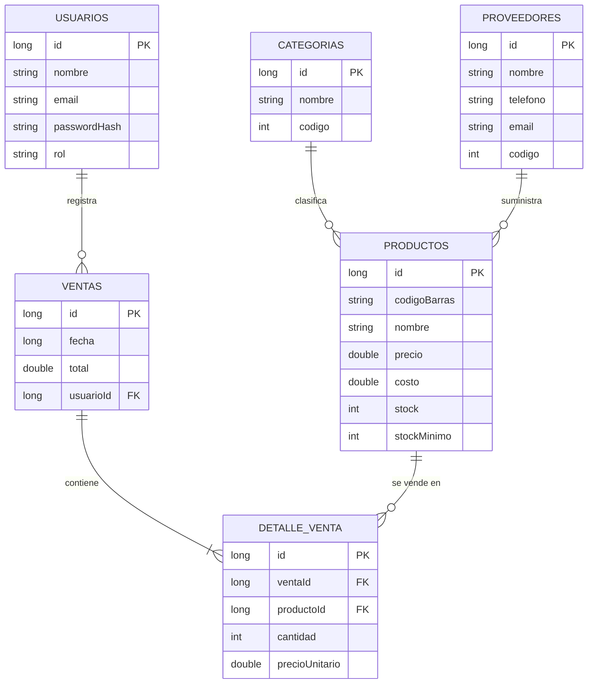

# Inventario PyME 📦🛒

**Inventario PyME** es una aplicación Android para la **gestión de inventario y ventas de pequeños negocios** (tiendas, pupuserías, ferreterías, cafeterías, minisúper). Funciona **100 % sin conexión**: todos los datos se guardan en el propio dispositivo con **SQLite (Room)**, por lo que no necesita servidor, internet ni configuración previa.

> Proyecto final · Técnicas de Producción Industrial de Software · Universidad Tecnológica de El Salvador

---

## 📌 Datos del proyecto

| | |
| :--- | :--- |
| **Universidad** | Universidad Tecnológica de El Salvador (UTEC) |
| **Facultad / Escuela** | Informática y Ciencias Aplicadas · Desarrollo de Software |
| **Asignatura** | Técnicas de Producción Industrial de Software |
| **Docente** | Ing. Carlos Roberto Monroy Alfaro |
| **Ciclo / Sección** | 02-2026 · Sección 01 |
| **Grupo** | N.º `__` |
| **Integrantes** | `Nombre 1` · `Nombre 2` · `Nombre 3` · `Nombre 4` · `Nombre 5` · `Nombre 6` |

---

## 🎯 Descripción general

Muchos pequeños negocios llevan su inventario en cuadernos o de memoria: no saben exactamente cuánto stock tienen, descubren que un producto se agotó cuando un cliente lo pide, y cierran el día sin un reporte confiable de lo vendido.

**Inventario PyME** resuelve esto en un solo lugar:

- Registra **productos, categorías y proveedores**.
- Vende desde el celular **escaneando el código de barras** con la cámara.
- **Descuenta el stock automáticamente** en cada venta.
- **Alerta cuando un producto está por agotarse.**
- Muestra **reportes de ventas** por semana, mes y trimestre.
- Separa lo que puede hacer el **administrador** de lo que puede hacer el **vendedor**.

### Propuesta de valor

| Para el dueño | Para el vendedor |
| :--- | :--- |
| Sabe qué tiene, qué se vende y qué debe reponer | Cobra rápido: escanea, confirma y listo |
| Controla quién vende y cuánto | Interfaz simple con solo lo que necesita |
| Detecta faltantes antes de perder ventas | Evita errores de precio y de stock |
| No depende de internet ni de pagar un servicio | Funciona igual aunque no haya señal |

---

## 🧭 Objetivos

### Objetivo general
Desarrollar una aplicación Android que permita a pequeños negocios **controlar su inventario y registrar sus ventas de forma ágil, confiable y sin depender de internet**, aplicando buenas prácticas de ingeniería de software.

### Objetivos específicos
1. Implementar la gestión de productos, categorías y proveedores con **validaciones** que eviten datos inconsistentes.
2. Registrar ventas con **escaneo de código de barras** y descuento automático e íntegro del stock.
3. Generar **reportes y alertas** que apoyen la toma de decisiones (ventas por periodo, productos más vendidos, stock bajo).
4. Controlar el acceso mediante **roles** (administrador y vendedor) y almacenamiento seguro de contraseñas.
5. Construir una arquitectura **organizada y mantenible** (MVVM por capas) con una interfaz clara y usable.

---

## 🌟 Misión, visión y valores

**Misión.** Brindar a los pequeños negocios una herramienta móvil sencilla, gratuita y confiable que les permita organizar su inventario y sus ventas, para que dediquen su tiempo a atender a sus clientes y no a llevar cuentas a mano.

**Visión.** Ser la solución de referencia para la administración de pequeños comercios en El Salvador, que crezca con ellos hacia reportes más completos, respaldo en la nube y multisucursal.

**Valores.** Simplicidad · Confiabilidad de los datos · Accesibilidad (funciona sin internet) · Seguridad · Calidad de código.

---

## 👤 Público objetivo y casos de uso

| Tipo de negocio | Cómo lo aprovecha |
| :--- | :--- |
| 🏪 Tienda / minisúper | Venta por escáner, control de stock de abarrotes y bebidas |
| 🫓 Pupusería / comedor | Registro rápido de ventas y reporte diario de ingresos |
| 🔧 Ferretería | Catálogo amplio por categoría y proveedor, alertas de reposición |
| ☕ Cafetería | Ventas ágiles en horas pico y productos más vendidos |

---

## ✨ Funcionalidades

### 🔐 Acceso y roles
- Inicio de sesión local con usuario y contraseña (almacenada como **hash**, nunca en texto plano).
- Menú de inicio distinto según el rol: el vendedor solo ve lo que necesita para vender.
- Resumen del día en el inicio (ventas de hoy, número de ventas, productos con stock bajo).

### 🛒 Punto de Venta (POS)
- Búsqueda de productos por **nombre o código de barras**, o escaneo con la cámara.
- Carrito dinámico con control de cantidad y **validación de stock disponible**.
- Quitar un producto con opción de **Deshacer**.
- Confirmación de venta **transaccional**: o se guarda todo (venta, detalle y descuento de stock) o no se guarda nada.
- **Historial de ventas** con detalle y filtro por vendedor.

### 📷 Escáner de código de barras
- **CameraX + ML Kit**: lectura instantánea, solo de formatos de producto, sin lecturas duplicadas.
- Solicitud del permiso de cámara en tiempo de ejecución.
- Al escanear en el formulario de producto, avisa si el código **ya existe**.

### 📦 Productos
- Alta, edición y eliminación con confirmación.
- Búsqueda, resaltado de **stock bajo** por colores (normal / bajo / agotado).
- **Vista previa del código de barras** del producto, con opción de copiarlo, para verificación.
- Formulario organizado por secciones: identificación, precios, inventario y clasificación.
- El **costo** solo es visible para el administrador.

### 🏷️ Código de barras interno (productos sin código de fábrica)
Para productos que no traen código (pan, pupusas, granel) la app genera un **EAN-13 válido** cuyo contenido identifica la categoría y el proveedor:

| Posición | Dígitos | Significado |
| :---: | :---: | :--- |
| 1 | `2` | Uso interno (rango reservado por GS1 para tiendas) |
| 2–3 | `CC` | Código de la categoría |
| 4–5 | `PP` | Código del proveedor |
| 6–12 | `NNNNNNN` | Consecutivo |
| 13 | `V` | Dígito verificador |

Ejemplo: `2 01 01 0000001 3` → categoría 01, proveedor 01, producto n.º 1. Los códigos de fábrica se respetan tal cual.

### 🗂️ Catálogos
- **Categorías** y **proveedores** (contacto, teléfono, correo) con validación de datos.
- Cada categoría y proveedor tiene un **código propio** que alimenta el código de barras interno.
- No se pueden eliminar elementos que tengan productos asociados.

### 📊 Reportes (administrador)
- Selector de periodo: **Semana · Mes · 3 meses**.
- Indicadores: ventas del periodo, número de ventas y ticket promedio.
- **Gráfico de barras** dibujado con Canvas de Compose.
- **Top 5 de productos más vendidos** y **alertas de stock bajo**.

### 👥 Gestión de usuarios (administrador)
- Alta de nuevos usuarios con rol y contraseña segura.
- Desactivación y reactivación de usuarios.

---

## 🔑 Permisos por rol

| Función | 👑 Administrador | 🧾 Vendedor |
| :--- | :---: | :---: |
| Punto de venta | ✅ | ✅ |
| Historial de ventas | Todas (con filtro) | Las propias |
| Consultar productos | ✅ | ✅ (sin costos) |
| Crear / editar / eliminar productos | ✅ | ❌ |
| Catálogos (categorías y proveedores) | ✅ | ❌ |
| Reportes y estadísticas | ✅ | ❌ |
| Gestión de usuarios | ✅ | ❌ |

---

## 🛠️ Tecnologías utilizadas

| Capa | Tecnología | Para qué se usa |
| :--- | :--- | :--- |
| Lenguaje | **Kotlin** | Código de toda la aplicación |
| Interfaz | **Jetpack Compose + Material 3** | Pantallas declarativas, tema claro/oscuro |
| Navegación | **Navigation Compose** | Flujo entre pantallas y paso de resultados (escáner) |
| Arquitectura | **MVVM por capas** | Separación entre UI, estado, reglas de negocio y datos |
| Estado | **ViewModel + StateFlow / Flow** | Pantallas que se actualizan solas al cambiar los datos |
| Base de datos | **Room sobre SQLite** | Almacenamiento local, relaciones y transacciones |
| Cámara | **CameraX** | Vista previa y análisis de imagen |
| Códigos de barras | **ML Kit Barcode Scanning** · **ZXing** | Lectura con cámara y dibujo del código en la vista previa |
| Seguridad | **Hash de contraseñas** | Credenciales nunca guardadas en texto plano |
| Compilación | **Gradle (Kotlin DSL) + KSP** | Construcción y procesamiento de Room |

### ¿Por qué solo SQLite?
- **Cero dependencias externas:** se instala y funciona; ideal para negocios sin conexión estable.
- **Rapidez:** las consultas son locales y no hay latencia de red.
- **Privacidad:** los datos del negocio nunca salen del dispositivo.
- **Sencillez:** menos piezas que mantener y menos puntos de fallo.

---

## 🏗️ Arquitectura

```
┌─────────────────────────────────────────────┐
│  UI · Jetpack Compose + Material 3          │  Pantallas, componentes, navegación
└───────────────────┬─────────────────────────┘
                    │ StateFlow · eventos
┌───────────────────▼─────────────────────────┐
│  ViewModels                                 │  Estado de pantalla y validación de formularios
└───────────────────┬─────────────────────────┘
                    │ funciones suspend · Flow
┌───────────────────▼─────────────────────────┐
│  Repositorio                                │  Reglas de negocio y transacciones (ventas)
└───────────────────┬─────────────────────────┘
                    │ DAOs
┌───────────────────▼─────────────────────────┐
│  Room → SQLite  (base de datos local)       │  Entidades, consultas y relaciones
└─────────────────────────────────────────────┘
```

### Estructura del proyecto (simplificada)

```
app/src/main/java/com/utec/inventario/
├── InventarioApp.kt · MainActivity.kt
├── data/
│   ├── local/          Entidades, DAOs y AppDatabase (Room)
│   └── repository/     Repositorio con reglas de negocio
├── ui/
│   ├── navigation/     Rutas y NavGraph
│   ├── theme/          Colores, formas y tema
│   ├── components/     Elementos reutilizables (tarjetas, chips, diálogos)
│   └── login · home · venta · productos · maestros · reportes · usuarios · scanner
└── util/               Validaciones, hash, código de barras interno, rangos de fechas
```

### Modelo de datos



---

## ✅ Reglas de negocio y validaciones

- El **código de barras** es único; no se aceptan duplicados.
- El **precio** debe ser mayor a 0 y no puede ser menor al costo; el **stock** no puede ser negativo.
- Nombre, correo y teléfono se validan por formato antes de guardar.
- No se puede vender más unidades de las que hay en stock.
- La venta es **atómica**: si algo falla, no se guarda nada y el stock queda intacto.
- Un producto con ventas registradas no se puede eliminar.
- Las categorías y proveedores con productos asociados no se pueden eliminar.
- Las acciones destructivas piden confirmación.
- Las funciones de administración se bloquean para el rol vendedor.

---

## 🔑 Usuarios de demostración

La base de datos se crea sola la primera vez con usuarios, categorías, proveedores y productos de ejemplo.

| Usuario | Rol | Correo | Contraseña |
| :--- | :--- | :--- | :--- |
| Administrador | `ADMIN` | `admin@inventariopyme.com` | `Admin123456!` |
| Vendedor Principal | `VENDEDOR` | `vendedor@inventariopyme.com` | `Vendedor123456!` |

---

## 🚀 Instalación y ejecución

### Requisitos
- **Android Studio** (versión reciente) con **JDK 17**.
- Emulador (AVD) o celular con **Android 7.0 (API 24) o superior**.
- Para probar el escáner se recomienda un **celular físico** (el emulador solo ofrece una cámara virtual).

### Pasos
1. Clona o descomprime el proyecto y ábrelo en Android Studio.
2. Espera a que **Gradle** sincronice las dependencias.
3. Selecciona un dispositivo y pulsa **Run ▶** (`Shift + F10`).
4. Ingresa con uno de los usuarios de demostración.

> No hay servidor, Docker ni configuración adicional: **la app funciona incluso en modo avión**.

### Pruebas y APK
```bash
./gradlew testDebugUnitTest     # pruebas unitarias
./gradlew assembleDebug         # genera el APK en app/build/outputs/apk/debug/
```

### Permisos
- `CAMERA`: únicamente para escanear códigos de barras.

---

## 🎬 Guía para la exposición y el video (máx. 10 min)

| Tiempo | Qué mostrar | Qué explicar |
| :---: | :--- | :--- |
| 0:00–1:00 | Pantalla de inicio de sesión | Problema, objetivo, misión y visión |
| 1:00–2:00 | Android Studio y la app | **Entorno:** SDK mínimo (API 24), permisos, tecnologías |
| 2:00–3:00 | Estructura del proyecto y diagrama ER | MVVM por capas y cómo se relacionan los datos |
| 3:00–4:00 | Login como Admin y como Vendedor | Roles y diferencias en el menú |
| 4:00–5:30 | Productos y catálogos | CRUD, validaciones, código interno y vista previa |
| 5:30–7:30 | Punto de venta | Escáner, carrito, deshacer, confirmar y descuento de stock |
| 7:30–8:30 | Historial y reportes | Cómo los datos de la venta alimentan los reportes |
| 8:30–9:15 | Usuarios y **modo avión** | Funciona sin conexión; seguridad local |
| 9:15–10:00 | Conclusiones | Aportes, limitaciones y mejoras futuras |

### Mapa de la rúbrica

| Criterio | Dónde se evidencia |
| :--- | :--- |
| Entorno de la aplicación Android | Sección *Tecnologías* y *Instalación*; minuto 1:00 del video |
| Presentación en video | Guion anterior, con demostración de cada módulo |
| Funcionalidad del proyecto | Reglas de negocio, roles, escáner, reportes, validaciones adicionales |
| Contenido del documento | Este README, diagrama ER, capturas por módulo y manual de usuario |

### Preguntas frecuentes de la defensa

- **¿Por qué SQLite y no un servidor?** Porque el público objetivo trabaja muchas veces sin conexión estable; así se gana velocidad, privacidad y sencillez.
- **¿Cómo se asegura que una venta no deje el stock inconsistente?** Con una transacción de Room: valida el stock, guarda la venta y el detalle, y descuenta; si algo falla, se revierte todo.
- **¿Cómo se protege la información?** Las contraseñas se guardan con hash y las funciones administrativas se validan por rol; los datos permanecen en el dispositivo.
- **¿Qué pasa si se desinstala la app?** Los datos locales se pierden. La mejora prevista es una copia de seguridad.
- **¿Qué es el código de barras interno?** Un EAN-13 válido con prefijo de uso interno que codifica categoría, proveedor y consecutivo, para productos que no traen código.

---

## 🔭 Limitaciones y trabajo futuro

- Los datos viven en **un solo dispositivo**: no hay sincronización entre varios celulares.
- Respaldo y restauración de la base de datos.
- Exportación de reportes a PDF o CSV e impresión de tickets.
- Sincronización con la nube y panel web (arquitectura cliente-servidor).
- Soporte multisucursal, descuentos y promociones.
- Pruebas instrumentadas de interfaz.

---

## 📦 Entregables

`Grupo##_INVENTARIO.zip` con: documento del proyecto · manual de usuario · video demostración (máx. 10 min) · código fuente · presentación PPT.

---

## 📄 Licencia

Proyecto académico desarrollado con fines educativos para la Universidad Tecnológica de El Salvador.