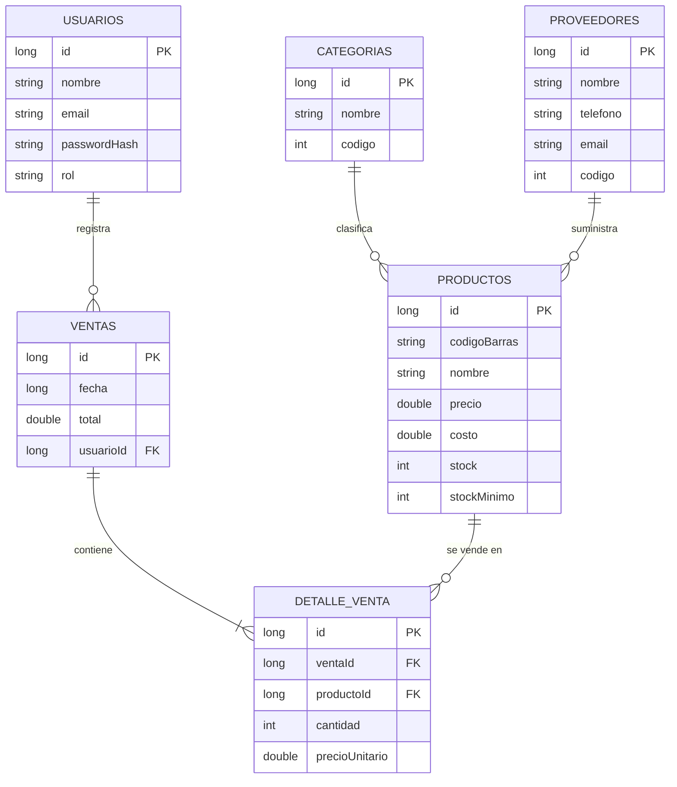

# Inventario PyME 📦🛒

**Inventario PyME** es una aplicación Android para la **gestión de inventario y ventas de pequeños negocios** (tiendas, pupuserías, ferreterías, cafeterías, minisúper). Funciona **100 % sin conexión**: todos los datos se guardan en el propio dispositivo con **SQLite (Room)**, por lo que no necesita servidor, internet ni configuración previa. Incluye **respaldos y traslado de datos**, control de acceso por **roles** y sesión con **cierre automático por inactividad**.

> Proyecto final · Técnicas de Producción Industrial de Software · Universidad Tecnológica de El Salvador

---

## 📌 Datos del proyecto

| | |
| :--- | :--- |
| **Universidad** | Universidad Tecnológica de El Salvador (UTEC) |
| **Facultad / Escuela** | Informática y Ciencias Aplicadas · Desarrollo de Software |
| **Asignatura** | Técnicas de Producción Industrial de Software |
| **Docente** | Ing. Carlos Roberto Monroy Alfaro |
| **Ciclo / Sección** | 02-2026 · Sección 01 |

---

## 🎯 Descripción general

Muchos pequeños negocios llevan su inventario en cuadernos o de memoria: no saben exactamente cuánto stock tienen, descubren que un producto se agotó cuando un cliente lo pide, y cierran el día sin un reporte confiable de lo vendido.

**Inventario PyME** resuelve esto en un solo lugar:

- Registra **productos, categorías y proveedores**.
- Vende desde el celular **escaneando el código de barras** con la cámara.
- **Descuenta el stock automáticamente** en cada venta.
- **Alerta cuando un producto está por agotarse.**
- Muestra **reportes de ventas** por semana, mes y 3 meses.
- Separa lo que puede hacer el **administrador** de lo que puede hacer el **vendedor**.
- **Protege la información** con respaldos, importación segura y cierre automático de sesión.

### Propuesta de valor

| Para el dueño | Para el vendedor |
| :--- | :--- |
| Sabe qué tiene, qué se vende y qué debe reponer | Cobra rápido: escanea, confirma y listo |
| Controla quién vende y cuánto | Interfaz simple con solo lo que necesita |
| Detecta faltantes antes de perder ventas | Evita errores de precio y de stock |
| Respalda su negocio y lo traslada a otro teléfono | Su sesión se cierra sola si deja el teléfono |
| No depende de internet ni de pagar un servicio | Funciona igual aunque no haya señal |

---

## 🧭 Objetivos

### Objetivo general
Desarrollar una aplicación Android que permita a pequeños negocios **controlar su inventario y registrar sus ventas de forma ágil, confiable y sin depender de internet**, aplicando buenas prácticas de ingeniería de software.

### Objetivos específicos
1. Implementar la gestión de productos, categorías y proveedores con **validaciones** que eviten datos inconsistentes.
2. Registrar ventas con **escaneo de código de barras** y descuento automático e íntegro del stock.
3. Generar **reportes y alertas** que apoyen la toma de decisiones (ventas por periodo, productos más vendidos, stock bajo).
4. Controlar el acceso mediante **roles** (administrador y vendedor), contraseñas con hash y **cierre automático de sesión por inactividad**.
5. Garantizar la **integridad y recuperación de los datos** mediante respaldos verificados, importación sin pérdida de información y confirmaciones en las acciones destructivas.
6. Construir una arquitectura **organizada y mantenible** (MVVM por capas) con una interfaz clara, usable y adaptable a tema claro y oscuro.

---

## 🌟 Misión, visión y valores

**Misión.** Brindar a los pequeños negocios una herramienta móvil sencilla, gratuita y confiable que les permita organizar su inventario y sus ventas, para que dediquen su tiempo a atender a sus clientes y no a llevar cuentas a mano.

**Visión.** Ser la solución de referencia para la administración de pequeños comercios en El Salvador, que crezca con ellos hacia reportes más completos, sincronización en la nube y multisucursal.

**Valores.** Simplicidad · Confiabilidad de los datos · Accesibilidad (funciona sin internet) · Seguridad · Calidad de código.

---

## 👤 Público objetivo y casos de uso

| Tipo de negocio | Cómo lo aprovecha |
| :--- | :--- |
| 🏪 Tienda / minisúper | Venta por escáner, control de stock de abarrotes y bebidas |
| 🫓 Pupusería / comedor | Registro rápido de ventas y reporte diario de ingresos |
| 🔧 Ferretería | Catálogo amplio por categoría y proveedor, alertas de reposición |
| ☕ Cafetería | Ventas ágiles en horas pico y productos más vendidos |

---

## ✨ Funcionalidades

### 🔐 Acceso, roles y sesión
- Inicio de sesión local con correo y contraseña (almacenada como **hash**, nunca en texto plano).
- **El correo no se guarda ni se rellena**: cada vez que aparece el login, los campos están vacíos.
- **Cierre automático de sesión:** si la app permanece cerrada o en segundo plano más de **10 minutos**, la sesión expira y se piden de nuevo correo y contraseña. Mientras se usa la app no se cierra sola.
- Al **cerrar sesión** (manual o automática) se limpia todo lo del usuario anterior y el botón «atrás» no regresa a pantallas protegidas.
- Menú de inicio distinto según el rol: el vendedor solo ve lo que necesita para vender.
- Resumen del día en el inicio (ventas de hoy, número de ventas, productos con stock bajo).

### 🛒 Punto de Venta (POS)
- Búsqueda de productos por **nombre o código de barras**, o escaneo con la cámara.
- Carrito dinámico con control de cantidad y **validación de stock disponible**.
- Quitar un producto con opción de **Deshacer**.
- Barra de total y cobro siempre visible, adaptada a los botones de navegación del dispositivo.
- Confirmación de venta **transaccional**: o se guarda todo (venta, detalle y descuento de stock) o no se guarda nada.
- **Historial de ventas** agrupado por día, con detalle. El administrador puede **filtrar por vendedor**.

### 📷 Escáner de código de barras
- **CameraX + ML Kit**: lectura instantánea, solo de formatos de producto, sin lecturas duplicadas.
- Solicitud del permiso de cámara en tiempo de ejecución.
- Al escanear en el formulario de producto, avisa si el código **ya existe**.

### 📦 Productos
- Alta, edición y eliminación con confirmación.
- **Filtros** en una sola fila: orden (nombre, stock, precio), **solo stock bajo** y categorías, combinables entre sí, además de la búsqueda por nombre o código.
- Resaltado de **stock** por colores (normal / bajo / agotado).
- **Vista previa del código de barras** del producto, con opción de copiarlo, para verificación.
- Formulario organizado por secciones: identificación, precios (con margen calculado), inventario y clasificación.
- El **costo** solo es visible para el administrador.

### 🏷️ Código de barras interno (productos sin código de fábrica)
Para productos que no traen código (pan, pupusas, granel) la app genera un **EAN-13 válido** cuyo contenido identifica la categoría y el proveedor:

| Posición | Dígitos | Significado |
| :---: | :---: | :--- |
| 1 | `2` | Uso interno (rango reservado por GS1 para tiendas) |
| 2–3 | `CC` | Código de la categoría |
| 4–5 | `PP` | Código del proveedor |
| 6–12 | `NNNNNNN` | Consecutivo |
| 13 | `V` | Dígito verificador |

Ejemplo: `2 01 01 0000001 3` → categoría 01, proveedor 01, producto n.º 1. Los códigos de fábrica se respetan tal cual.

### 🗂️ Catálogos
- **Categorías** y **proveedores** (contacto, teléfono, correo) con validación de datos.
- Cada categoría y proveedor tiene un **código propio** que alimenta el código de barras interno.
- No se pueden eliminar elementos que tengan productos asociados.

### 📊 Reportes (administrador)
- Selector de periodo: **Semana · Mes · 3 meses**.
- Indicadores: ventas del periodo, número de ventas y ticket promedio.
- **Gráfico de barras** dibujado con Canvas de Compose.
- **Top 5 de productos más vendidos** y **alertas de stock bajo**.

### 👥 Gestión de usuarios (administrador)
- Alta de nuevos usuarios con rol y contraseña segura.
- Desactivación y reactivación de usuarios.

### ⚙️ Ajustes
- **Apariencia:** tema **Claro**, **Oscuro** o **Automático** (según el sistema). Se aplica al instante y se recuerda al reabrir la app.
- **Ajustes avanzados** (visible solo para el administrador): respaldos y manejo de datos.
- Información de la app.

### 💾 Respaldos y datos (Ajustes avanzados · solo administrador)

**Acceso a archivos.** Una tarjeta de estado indica si el permiso está activo. Exportar, importar y eliminar solo funcionan con el acceso concedido, para que nunca se modifiquen datos sin una copia de seguridad. El botón *Conceder acceso* guía paso a paso hasta la configuración del sistema.

**Exportar respaldo**
- Genera un archivo **JSON** con categorías, proveedores, productos, ventas y detalle de ventas.
- Se guarda **automáticamente** en `Inventario PYME › Respaldos de Datos`, sin elegir carpeta.
- **Verificación de integridad:** antes de guardar se comprueba que el archivo esté completo (los conteos de cada tabla deben coincidir). Un respaldo incompleto nunca se conserva.
- Al terminar muestra la ruta y la cantidad de registros exportados.

**Importar respaldo**
- Todos los registros entran como **NUEVOS**, **por encima de los existentes**: no se modifica ni se elimina ningún dato, y no se comparan duplicados.
- Un aviso previo lo explica y el selector se abre directamente en la carpeta *Respaldos de Datos*.
- Se valida el archivo completo antes de escribir y la inserción es **atómica** (entra todo o no entra nada).
- Si un dato con valor único ya existe (código de barras, nombre de categoría), el importado se renombra con el sufijo *(importado)* para no rechazar la importación.
- Las ventas importadas **no modifican el stock**; se asignan por **correo** al vendedor que exista en el dispositivo o, si no existe, al administrador actual.
- Se guardan dos **copias automáticas** (antes y después) en `Respaldos de Datos › Otros`.

**Eliminar todos los datos**
- Se ubica en una **zona de peligro** al final de la pantalla.
- Su botón de confirmación se habilita solo tras una **carga de 3 segundos**, para evitar borrados accidentales.
- Antes de borrar se crea una copia automática en `Otros`.
- Elimina productos, categorías, proveedores y ventas. **Los usuarios no se eliminan.**

> **Los usuarios no forman parte de los respaldos:** no se exportan ni se importan, así no se duplica al administrador. En un teléfono nuevo se crean a mano.

#### Dónde quedan los archivos

```
Almacenamiento interno/
└── Inventario PYME/
    └── Respaldos de Datos/
        ├── InventarioPYME_AAAA-MM-DD_HH-mm-ss.json            ← exportaciones manuales
        └── Otros/                                               ← copias automáticas
            ├── InventarioPYME_previo-a-importar_<fecha>.json
            ├── InventarioPYME_posterior-a-importar_<fecha>.json
            └── InventarioPYME_previo-a-eliminar_<fecha>.json
```

---

## 🔑 Permisos por rol

| Función | 👑 Administrador | 🧾 Vendedor |
| :--- | :---: | :---: |
| Punto de venta | ✅ | ✅ |
| Historial de ventas | Todas (con filtro) | Las propias |
| Consultar productos | ✅ | ✅ (sin costos) |
| Crear / editar / eliminar productos | ✅ | ❌ |
| Catálogos (categorías y proveedores) | ✅ | ❌ |
| Reportes y estadísticas | ✅ | ❌ |
| Gestión de usuarios | ✅ | ❌ |
| Ajustes (tema) | ✅ | ✅ |
| Ajustes avanzados (respaldos y datos) | ✅ | ❌ |

---

## 🛠️ Tecnologías utilizadas

| Capa | Tecnología | Para qué se usa |
| :--- | :--- | :--- |
| Lenguaje | **Kotlin** | Código de toda la aplicación |
| Interfaz | **Jetpack Compose + Material 3** | Pantallas declarativas, tema claro/oscuro |
| Navegación | **Navigation Compose** | Flujo entre pantallas y paso de resultados (escáner) |
| Arquitectura | **MVVM por capas** | Separación entre UI, estado, reglas de negocio y datos |
| Estado | **ViewModel + StateFlow / Flow** | Pantallas que se actualizan solas al cambiar los datos |
| Base de datos | **Room sobre SQLite** | Almacenamiento local, relaciones y transacciones |
| Cámara | **CameraX** | Vista previa y análisis de imagen |
| Códigos de barras | **ML Kit Barcode Scanning** · **ZXing** | Lectura con cámara y dibujo del código en la vista previa |
| Respaldos | **JSON (lectura y escritura en streaming)** · **API de archivos de Android** | Exportación e importación con verificación de integridad |
| Selector de archivos | **Storage Access Framework** (`OpenDocument`) | Elegir el respaldo a importar |
| Sesión | **ProcessLifecycleOwner** + preferencias locales | Detectar cuánto tiempo estuvo la app fuera y expirar la sesión |
| Seguridad | **Hash de contraseñas** | Credenciales nunca guardadas en texto plano |
| Compilación | **Gradle (Kotlin DSL) + KSP** | Construcción y procesamiento de Room |

### ¿Por qué solo SQLite?
- **Cero dependencias externas:** se instala y funciona; ideal para negocios sin conexión estable.
- **Rapidez:** las consultas son locales y no hay latencia de red.
- **Privacidad:** los datos del negocio nunca salen del dispositivo.
- **Sencillez:** menos piezas que mantener y menos puntos de fallo.

---

## 🏗️ Arquitectura

```
┌─────────────────────────────────────────────┐
│  UI · Jetpack Compose + Material 3          │  Pantallas, componentes, navegación
└───────────────────┬─────────────────────────┘
                    │ StateFlow · eventos
┌───────────────────▼─────────────────────────┐
│  ViewModels                                 │  Estado de pantalla y validación de formularios
└───────────────────┬─────────────────────────┘
                    │ funciones suspend · Flow
┌───────────────────▼─────────────────────────┐
│  Repositorio · Almacén de respaldos         │  Reglas de negocio, transacciones y respaldos
└───────────────────┬─────────────────────────┘
                    │ DAOs
┌───────────────────▼─────────────────────────┐
│  Room → SQLite  (base de datos local)       │  Entidades, consultas y relaciones
└─────────────────────────────────────────────┘
```

### Estructura del proyecto (simplificada)

```
app/src/main/java/com/utec/inventario/
├── InventarioApp.kt · MainActivity.kt
├── data/
│   ├── local/          Entidades, DAOs y AppDatabase (Room)
│   └── repository/     Repositorio con reglas de negocio y manejo de respaldos
├── ui/
│   ├── navigation/     Rutas y NavGraph
│   ├── theme/          Colores, formas y tema claro/oscuro
│   ├── components/     Elementos reutilizables (tarjetas, chips, diálogos, AppScaffold)
│   └── login · home · venta · productos · maestros · reportes · usuarios · scanner · ajustes
└── util/               Validaciones, hash, código de barras interno, rangos de fechas, sesión
```

### Modelo de datos



---

## ✅ Reglas de negocio y validaciones

**Inventario y ventas**
- El **código de barras** es único; no se aceptan duplicados.
- El **precio** debe ser mayor a 0 y no puede ser menor al costo; el **stock** no puede ser negativo.
- Nombre, correo y teléfono se validan por formato antes de guardar.
- No se puede vender más unidades de las que hay en stock.
- La venta es **atómica**: si algo falla, no se guarda nada y el stock queda intacto.
- Un producto con ventas registradas no se puede eliminar.
- Las categorías y proveedores con productos asociados no se pueden eliminar.

**Seguridad y datos**
- Las funciones de administración se bloquean para el rol vendedor, tanto en la interfaz como en la lógica.
- La sesión expira tras 10 minutos de inactividad fuera de la app.
- Las acciones destructivas piden confirmación; **eliminar todos los datos** exige además una espera de 3 segundos.
- Exportar, importar y eliminar requieren el acceso a archivos concedido y crean antes una copia de seguridad.
- Un respaldo se guarda solo si pasa la verificación de integridad.
- Importar nunca modifica ni elimina datos existentes y es todo-o-nada.

---

## 🔑 Usuarios de demostración

La base de datos se crea sola la primera vez con usuarios, categorías, proveedores y productos de ejemplo.

| Usuario | Rol | Correo | Contraseña |
| :--- | :--- | :--- | :--- |
| Administrador | `ADMIN` | `admin@inventariopyme.com` | `Admin123456!` |
| Vendedor Principal | `VENDEDOR` | `vendedor@inventariopyme.com` | `Vendedor123456!` |

---

## 🚀 Instalación y ejecución

### Requisitos
- **Android Studio** (versión reciente) con **JDK 17**.
- Emulador (AVD) o celular con **Android 7.0 (API 24) o superior**.
- Para probar el escáner se recomienda un **celular físico** (el emulador solo ofrece una cámara virtual).

### Pasos
1. Clona o descomprime el proyecto y ábrelo en Android Studio.
2. Espera a que **Gradle** sincronice las dependencias.
3. Selecciona un dispositivo y pulsa **Run ▶** (`Shift + F10`).
4. Ingresa con uno de los usuarios de demostración.

> No hay servidor, Docker ni configuración adicional: **la app funciona incluso en modo avión**.

### Pruebas y APK
```bash
./gradlew testDebugUnitTest     # pruebas unitarias
./gradlew assembleDebug         # genera el APK en app/build/outputs/apk/debug/
```

### Permisos
| Permiso | Para qué |
| :--- | :--- |
| `CAMERA` | Escanear códigos de barras |
| Acceso a todos los archivos (`MANAGE_EXTERNAL_STORAGE`, Android 11+) · almacenamiento (`WRITE_EXTERNAL_STORAGE`, Android 10 o menos) | Guardar y leer respaldos en `Inventario PYME › Respaldos de Datos` |

La app **no usa internet**.

### Cómo activar el acceso a archivos (para respaldos)
1. Entra como **administrador** → **Ajustes** → **Ajustes avanzados**.
2. Pulsa **Conceder acceso** y luego **Continuar**.
3. En la configuración del sistema busca **Inventario PyME** y activa el permiso de acceso a todos los archivos.
4. Regresa a la app: la tarjeta cambia a *«Acceso a archivos activado»*.

---

### Mapa de la rúbrica

| Criterio | Dónde se evidencia |
| :--- | :--- |
| Entorno de la aplicación Android | Secciones *Tecnologías*, *Permisos* e *Instalación*; minuto 0:45 del video |
| Funcionalidad del proyecto | Reglas de negocio, roles, escáner, reportes, respaldos y validaciones adicionales |
| Contenido del documento | Este README, diagrama ER, capturas por módulo y manual de usuario |
| Bonificación (uso creativo) | Código de barras EAN-13 interno, respaldos verificados, importación sin pérdida de datos, sesión por inactividad y tema claro/oscuro |

### Preguntas frecuentes de la defensa

- **¿Por qué SQLite y no un servidor?** Porque el público objetivo trabaja muchas veces sin conexión estable; así se gana velocidad, privacidad y sencillez.
- **¿Cómo se asegura que una venta no deje el stock inconsistente?** Con una transacción de Room: valida el stock, guarda la venta y el detalle, y descuenta; si algo falla, se revierte todo.
- **¿Cómo se protege la información?** Contraseñas con hash, funciones administrativas validadas por rol, cierre automático de sesión y datos que nunca salen del dispositivo.
- **¿Qué pasa si se desinstala la app?** La base de datos local se pierde, pero los respaldos guardados en la carpeta `Inventario PYME` permanecen y se pueden importar.
- **¿Se pueden pasar los datos a otro teléfono?** Sí: se exporta un respaldo, se copia el archivo y se importa en el otro dispositivo. Es un **traslado manual**, no una sincronización automática.
- **¿Por qué importar duplica los registros?** Es una decisión de diseño para **evitar a toda costa la pérdida de datos**: no se compara ni se sobrescribe nada, y antes y después de importar se guardan copias automáticas.
- **¿Por qué los usuarios no se exportan?** Para no duplicar al administrador ni mover contraseñas entre dispositivos. Las ventas importadas se asignan por correo al vendedor existente.
- **¿Por qué pide acceso a todos los archivos?** Para guardar los respaldos en una carpeta visible y permanente (`Inventario PYME`) que sobreviva a la desinstalación.
- **¿Qué es el código de barras interno?** Un EAN-13 válido con prefijo de uso interno que codifica categoría, proveedor y consecutivo, para productos que no traen código.

---

## 🔭 Limitaciones y trabajo futuro

- Los datos viven en **un solo dispositivo**: el traslado entre teléfonos es manual, sin sincronización automática.
- Importación inteligente que **fusione** registros y detecte duplicados.
- Pantalla de **perfil** de usuario con cambio de contraseña y estadísticas personales.
- Exportación de reportes a PDF o CSV e impresión de tickets.
- Sincronización con la nube y panel web (arquitectura cliente-servidor).
- Soporte multisucursal, descuentos y promociones.
- Pruebas instrumentadas de interfaz.

---

## 📄 Licencia

Proyecto académico desarrollado con fines educativos para la Universidad Tecnológica de El Salvador.