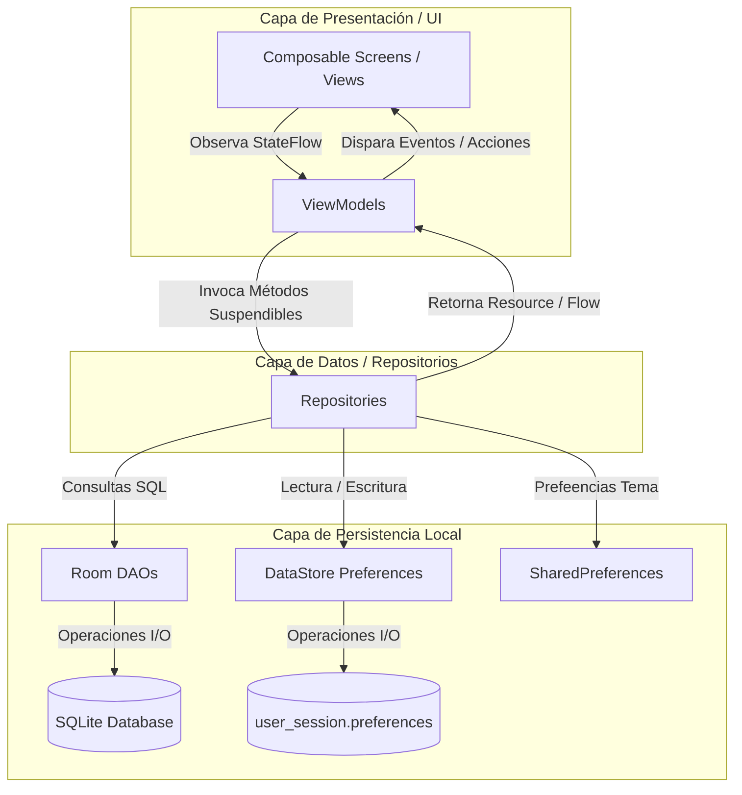
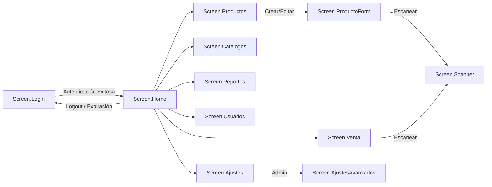

[← Volver al índice](../DOCUMENTACION_TECNICA.md#indice)

### En este capítulo
- [2.a Patrón arquitectónico MVVM y estratificación por capas](#c2a)
- [2.b Contenedor de dependencias e inyección manual (AppContainer)](#c2b)
- [2.c Flujo de datos, estado inmutable y reactividad (StateFlow y SharedFlow)](#c2c)
- [2.d Sistema de navegación centralizado y rutas (NavGraph y Screen)](#c2e)
- [2.e Interoperabilidad y comunicación entre pantallas](#c2e)

---

<a id="c2"></a>
## 2. Arquitectura

<a id="c2a"></a>
### 2.a Patrón arquitectónico MVVM y estratificación por capas

La aplicación **Inventario PyME** implementa una arquitectura limpia y reactiva fundamentada en las directrices recomendadas por la guía oficial de arquitectura de Android (*Android Architecture Guidelines*), basada en la separación estricta de responsabilidades mediante el patrón **MVVM (Model-View-ViewModel)** organizado en tres capas primarias:



#### Responsabilidades por Capa:

1. **Capa de Presentación (UI Layer)**:
   - **Vistas (Composables)**: Construidas mediante **Jetpack Compose** y **Material Design 3**. Son componentes declarativos, sin estado interno de negocio (*stateless* en la medida de lo posible). Reciben el estado inmutable desde los ViewModels mediante `collectAsState()` y emiten eventos de interacción del usuario (clicks, texto ingresado, gestos).
   - **ViewModels**: Derivados de `androidx.lifecycle.ViewModel`. Preservan el estado de la pantalla a través de cambios de configuración (rotación, cambio de tema). Transforman las peticiones de la UI en llamadas asíncronas hacia la capa de repositorios utilizando **Corrutinas de Kotlin** (`viewModelScope.launch`) y exponen el estado resultante mediante `StateFlow<UiState>`.

2. **Capa de Datos (Data Layer)**:
   - **Repositorios**: Actúan como una mediación entre la lógica de negocio y las fuentes de datos locales. Abstraen el origen de la información y aplican transformaciones entre las Entidades de la base de datos (`Entity`) y los Objetos de Transferencia de Datos (`Dto`). Retornan resultados envueltos en la clase sellada `Resource<T>` (`Success`, `Error`, `Loading`).
   - **Objetos de Acceso a Datos (DAOs)**: Interfaces anotadas con `@Dao` de Room que definen las operaciones CRUD y consultas SQL sobre SQLite.
   - **DataStore Preferences / SharedPreferences**: Fuentes de datos clave-valor para la persistencia de sesión activa (`TokenStore`) y configuración de tema/respaldos (`PreferenciasManager`).

---

<a id="c2b"></a>
### 2.b Contenedor de dependencias e inyección manual (AppContainer)

La aplicación prescinde de frameworks de inyección de dependencias como Hilt o Dagger para mantener la simplicidad, el control directo del código y evitar tiempos de compilación elevados. En su lugar, utiliza un patrón de **Inyección de Dependencias Manual** centralizado en la clase [AppContainer.kt](file:///C:/Users/Administrador/Desktop/GestionInventarios/app/src/main/java/com/example/gestioninventarios/AppContainer.kt).

#### Inicialización e Instanciación perezosa (Lazy):
El `AppContainer` se instancía una sola vez durante el ciclo de vida de la aplicación en la clase [GestionInventariosApp.kt](file:///C:/Users/Administrador/Desktop/GestionInventarios/app/src/main/java/com/example/gestioninventarios/GestionInventariosApp.kt). Todos los componentes se declaran con la propiedad `by lazy`, garantizando que únicamente se instancien cuando son requeridos por primera vez:

```kotlin
class AppContainer(private val context: Context) {
    val preferenciasManager: PreferenciasManager by lazy { PreferenciasManager(context) }
    val almacenRespaldos: AlmacenRespaldos by lazy { AlmacenRespaldos(context) }
    val tokenStore: TokenStore by lazy { TokenStore(context) }
    val sesionManager: SesionManager by lazy { SesionManager(context, tokenStore) }
    val appDatabase: AppDatabase by lazy { AppDatabase.getDatabase(context) }

    val authRepository: AuthRepository by lazy { AuthRepository(appDatabase.usuarioDao(), tokenStore) }
    val categoriaRepository: CategoriaRepository by lazy { CategoriaRepository(appDatabase.categoriaDao(), appDatabase.productoDao()) }
    val proveedorRepository: ProveedorRepository by lazy { ProveedorRepository(appDatabase.proveedorDao(), appDatabase.productoDao()) }
    val productoRepository: ProductoRepository by lazy { ProductoRepository(appDatabase.productoDao(), appDatabase.categoriaDao(), appDatabase.proveedorDao()) }
    val ventaRepository: VentaRepository by lazy { VentaRepository(appDatabase.ventaDao(), appDatabase.productoDao(), tokenStore) }
    val reporteRepository: ReporteRepository by lazy { ReporteRepository(appDatabase.ventaDao(), appDatabase.productoDao()) }
    val usuarioRepository: UsuarioRepository by lazy { UsuarioRepository(appDatabase.usuarioDao()) }
}
```

#### Proveedor de ViewModels (ViewModelFactory):
Para proveer los ViewModels parametrizados a las pantallas de Jetpack Compose, se utiliza la clase [ViewModelFactory.kt](file:///C:/Users/Administrador/Desktop/GestionInventarios/app/src/main/java/com/example/gestioninventarios/ui/ViewModelFactory.kt), la cual implementa `ViewModelProvider.Factory`.

| ViewModel Creado | Dependencias Inyectadas desde AppContainer |
| :--- | :--- |
| `LoginViewModel` | `authRepository` |
| `HomeViewModel` | `authRepository`, `reporteRepository`, `ventaRepository`, `productoRepository` |
| `ProductosViewModel` | `productoRepository`, `categoriaRepository`, `proveedorRepository`, `authRepository` |
| `ProductoFormViewModel` | `productoRepository`, `categoriaRepository`, `proveedorRepository` |
| `CatalogosViewModel` | `categoriaRepository`, `proveedorRepository`, `productoRepository`, `authRepository` |
| `VentaViewModel` | `productoRepository`, `ventaRepository`, `authRepository` |
| `ReportesViewModel` | `reporteRepository`, `ventaRepository`, `productoRepository` |
| `UsuariosViewModel` | `usuarioRepository`, `authRepository` |
| `AjustesViewModel` | `preferenciasManager`, `tokenStore` |
| `AjustesAvanzadosViewModel` | `appDatabase`, `preferenciasManager`, `almacenRespaldos`, `tokenStore` |

---

<a id="c2c"></a>
### 2.c Flujo de datos, estado inmutable y reactividad (StateFlow y SharedFlow)

El flujo de información en la capa de presentación sigue el principio de **Unidirectional Data Flow (UDF)**:
1. El ViewModel mantiene un `MutableStateFlow<UiState>` privado.
2. La vista (Composable) expone públicamente un `StateFlow<UiState>` inmutable mediante `asStateFlow()`.
3. La interfaz se recompone automáticamente ante cualquier cambio en el estado.
4. Las acciones del usuario se transmiten al ViewModel mediante llamadas a funciones públicas.

#### Ejemplo de patrón UDF en VentaViewModel:
```kotlin
// Estado inmutable de la pantalla
data class VentaUiState(
    val cart: List<CartItem> = emptyList(),
    val total: Double = 0.0,
    val isLoading: Boolean = false,
    val errorMessage: String? = null
)

class VentaViewModel(...) : ViewModel() {
    private val _uiState = MutableStateFlow(VentaUiState())
    val uiState: StateFlow<VentaUiState> = _uiState.asStateFlow()

    // Eventos de un solo tiro (One-shot events)
    private val _eventos = Channel<VentaEvento>(Channel.BUFFERED)
    val eventos: Flow<VentaEvento> = _eventos.receiveAsFlow()
}
```

#### Manejo de Eventos de Única Ejecución (One-Shot Events):
Para acciones efímeras que no deben persistir tras recomposiciones o cambios de configuración (como mostrar un Snackbar con la opción de deshacer o navegar tras guardar), se utiliza un `Channel<T>` expuesto como `Flow<T>` (`receiveAsFlow()`) o un `SharedFlow<T>`.

---

<a id="c2d"></a>
### 2.d Sistema de navegación centralizado y rutas (NavGraph y Screen)

La navegación entre pantallas se administra con Jetpack Navigation Compose en [NavGraph.kt](file:///C:/Users/Administrador/Desktop/GestionInventarios/app/src/main/java/com/example/gestioninventarios/ui/navigation/NavGraph.kt). Las rutas están fuertemente tipadas en la clase sellada [Screen.kt](file:///C:/Users/Administrador/Desktop/GestionInventarios/app/src/main/java/com/example/gestioninventarios/ui/navigation/Screen.kt).

#### Definición de Rutas (`Screen.kt`):
```kotlin
sealed class Screen(val route: String) {
    object Login : Screen("login")
    object Home : Screen("home")
    object Productos : Screen("productos")
    object ProductoForm : Screen("producto_form?id={id}") {
        fun createRoute(id: Int? = null) = if (id != null) "producto_form?id=$id" else "producto_form"
    }
    object Catalogos : Screen("catalogos")
    object Venta : Screen("venta")
    object Scanner : Screen("scanner")
    object Reportes : Screen("reportes")
    object Usuarios : Screen("usuarios")
    object Ajustes : Screen("ajustes")
    object AjustesAvanzados : Screen("ajustes_avanzados")
}
```

#### Grafo de Navegación y Destino Inicial Dinámico:
En `NavGraph.kt`, el destino inicial (`startDestination`) se evalúa dinámicamente observando el estado de autenticación en `TokenStore`:
- Si `isLoggedIn == true`: Se inicia en `Screen.Home.route`.
- Si `isLoggedIn == false`: Se inicia en `Screen.Login.route`.
- Mientras se resuelve el estado inicial (`isLoggedInState == null`), se muestra un indicador de carga central (`CircularProgressIndicator`).



---

<a id="c2e"></a>
### 2.e Interoperabilidad y comunicación entre pantallas

El paso de resultados entre pantallas que no comparten ViewModel se realiza mediante el objeto `savedStateHandle` de `NavBackStackEntry`.

#### Flujo de Retorno de Resultados del Escáner:
1. **Navegación al Escáner**: Desde `VentaScreen` o `ProductoFormScreen`, se navega a `Screen.Scanner.route`.
2. **Captura y Retorno**: Al detectar un código de barras en `ScannerScreen`, la pantalla escribe el resultado en el `savedStateHandle` de la pantalla anterior y ejecuta `popBackStack()`:
   ```kotlin
   navController.previousBackStackEntry?.savedStateHandle?.set("scanned_barcode", barcode)
   navController.previousBackStackEntry?.savedStateHandle?.set("codigo", barcode)
   navController.popBackStack()
   ```
3. **Consumo del Resultado**:
   - En `VentaScreen`: Se observa el argumento `scanned_barcode`, se procesa en el `VentaViewModel` mediante `onBarcodeScanned(barcode)` y posteriormente se elimina la clave de `savedStateHandle`.
   - En `ProductoFormScreen`: Se observa el argumento `codigo` mediante un `StateFlow` y se asigna al campo del formulario llamando a `viewModel.onCodigoScanned(code)`.

[← Volver al índice](../DOCUMENTACION_TECNICA.md#indice)
