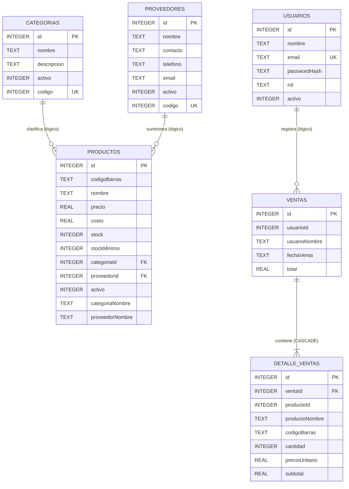

[← Volver al índice](../DOCUMENTACION_TECNICA.md#indice)

### En este capítulo
- [3.a Configuración de RoomDatabase y versionamiento (AppDatabase)](#c3a)
- [3.b Entidades de datos y diseño relacional (Entities)](#c3b)
- [3.c Objetos de Acceso a Datos (DAOs) y consultas SQL](#c3c)
- [3.d Estrategia de migraciones de esquema (MIGRATION_1_2, 2_3, 3_4)](#c3d)
- [3.e Sembrado inicial de datos demo (seedInitialData)](#c3e)

---

<a id="c3"></a>
## 3. Base de datos (Room/SQLite)

<a id="c3a"></a>
### 3.a Configuración de RoomDatabase y versionamiento (AppDatabase)

La base de datos relacional local de la aplicación está implementada con la biblioteca oficial **Room** sobre SQLite. La clase abstracta principal es [AppDatabase.kt](file:///C:/Users/Administrador/Desktop/GestionInventarios/app/src/main/java/com/example/gestioninventarios/data/local/AppDatabase.kt).

#### Propiedades del Sistema de Base de Datos:
- **Nombre de Archivo SQLite**: `inventario_pyme_db`
- **Versión de Esquema Actual**: `4`
- **Exportación de Esquema**: `exportSchema = false`
- **Patrón Singleton**: Implementado con cerrojo de doble comprobación (`@Volatile` e `synchronized(this)`).
- **Control de Migraciones**: Registra las migraciones `MIGRATION_1_2`, `MIGRATION_2_3` y `MIGRATION_3_4`.

---

<a id="c3b"></a>
### 3.b Entidades de datos y diseño relacional (Entities)

La base de datos se compone de 6 tablas relacionales. A continuación se detalla la estructura completa de campos, tipos SQLite, nulabilidad, claves primarias, índices y relaciones:

#### 1. Tabla `categorias` ([CategoriaEntity.kt](file:///C:/Users/Administrador/Desktop/GestionInventarios/app/src/main/java/com/example/gestioninventarios/data/local/entity/CategoriaEntity.kt))
Armazena las categorías para clasificar los productos del inventario.

| Campo | Tipo SQLite | Nulo | Clave / Índice | Descripción |
| :--- | :--- | :--- | :--- | :--- |
| `id` | `INTEGER` | NO | Primary Key | Identificador único numérico. |
| `nombre` | `TEXT` | NO | - | Nombre de la categoría (ej. "Bebidas"). |
| `descripcion` | `TEXT` | SÍ | - | Descripción detallada de la categoría. |
| `activo` | `INTEGER` (Boolean) | NO | - | Estado de borrado lógico (1=Activo, 0=Eliminado). |
| `codigo` | `INTEGER` | NO | Único (`index_categorias_codigo`) | Código numérico interno consecutivo (1 a 99). |

#### 2. Tabla `proveedores` ([ProveedorEntity.kt](file:///C:/Users/Administrador/Desktop/GestionInventarios/app/src/main/java/com/example/gestioninventarios/data/local/entity/ProveedorEntity.kt))
Almacena la información de contacto de los proveedores.

| Campo | Tipo SQLite | Nulo | Clave / Índice | Descripción |
| :--- | :--- | :--- | :--- | :--- |
| `id` | `INTEGER` | NO | Primary Key | Identificador único numérico. |
| `nombre` | `TEXT` | NO | - | Nombre comercial del proveedor. |
| `contacto` | `TEXT` | SÍ | - | Nombre de la persona de contacto. |
| `telefono` | `TEXT` | SÍ | - | Teléfono de atención o pedidos. |
| `email` | `TEXT` | SÍ | - | Correo electrónico comercial. |
| `activo` | `INTEGER` (Boolean) | NO | - | Estado de borrado lógico (1=Activo, 0=Eliminado). |
| `codigo` | `INTEGER` | NO | Único (`index_proveedores_codigo`) | Código numérico interno consecutivo (1 a 99). |

#### 3. Tabla `usuarios` ([UsuarioEntity.kt](file:///C:/Users/Administrador/Desktop/GestionInventarios/app/src/main/java/com/example/gestioninventarios/data/local/entity/UsuarioEntity.kt))
Almacena las cuentas de usuario y credenciales del sistema.

| Campo | Tipo SQLite | Nulo | Clave / Índice | Descripción |
| :--- | :--- | :--- | :--- | :--- |
| `id` | `INTEGER` | NO | PK Autoincremental | Identificador del usuario. |
| `nombre` | `TEXT` | NO | - | Nombre completo del usuario. |
| `email` | `TEXT` | NO | Único (`index_usuarios_email`) | Correo electrónico usado para iniciar sesión. |
| `passwordHash` | `TEXT` | NO | - | Hash o texto plano de la contraseña (ver Observaciones). |
| `rol` | `TEXT` | NO | - | Rol de usuario (`ADMIN` o `VENDEDOR`). |
| `activo` | `INTEGER` (Boolean) | NO | - | Estado de habilitación (1=Activo, 0=Desactivado). |

#### 4. Tabla `productos` ([ProductoEntity.kt](file:///C:/Users/Administrador/Desktop/GestionInventarios/app/src/main/java/com/example/gestioninventarios/data/local/entity/ProductoEntity.kt))
Almacena el catálogo de productos y existencias de almacén.

| Campo | Tipo SQLite | Nulo | Clave / Índice | Descripción |
| :--- | :--- | :--- | :--- | :--- |
| `id` | `INTEGER` | NO | Primary Key | Identificador único del producto. |
| `codigoBarras` | `TEXT` | NO | Índice (`index_productos_codigoBarras`) | Código EAN-13 o personalizado. |
| `nombre` | `TEXT` | NO | - | Nombre comercial del producto. |
| `precio` | `REAL` (Double) | NO | - | Precio de venta al público en USD. |
| `costo` | `REAL` (Double) | NO | - | Costo de adquisición por unidad. |
| `stock` | `INTEGER` | NO | - | Cantidad actual disponible en inventario. |
| `stockMinimo` | `INTEGER` | NO | - | Umbral para alerta de stock bajo. |
| `categoriaId` | `INTEGER` | NO | Índice (`index_productos_categoriaId`) | FK hacia `categorias.id` (Desnormalizada). |
| `proveedorId` | `INTEGER` | NO | Índice (`index_productos_proveedorId`) | FK hacia `proveedores.id` (Desnormalizada). |
| `activo` | `INTEGER` (Boolean) | NO | Índice (`index_productos_activo`) | Estado de borrado lógico (1=Activo, 0=Eliminado). |
| `categoriaNombre` | `TEXT` | SÍ | - | Nombre de la categoría desnormalizado. |
| `proveedorNombre` | `TEXT` | SÍ | - | Nombre del proveedor desnormalizado. |

#### 5. Tabla `ventas` ([VentaEntity.kt](file:///C:/Users/Administrador/Desktop/GestionInventarios/app/src/main/java/com/example/gestioninventarios/data/local/entity/VentaEntity.kt))
Encabezado de las transacciones registradas en el Punto de Venta.

| Campo | Tipo SQLite | Nulo | Clave / Índice | Descripción |
| :--- | :--- | :--- | :--- | :--- |
| `id` | `INTEGER` | NO | PK Autoincremental | Folio o número de ticket de venta. |
| `usuarioId` | `INTEGER` | NO | - | ID del vendedor que realizó la transacción. |
| `usuarioNombre` | `TEXT` | NO | - | Nombre del vendedor desnormalizado. |
| `fechaVenta` | `TEXT` | NO | - | Marca de tiempo ISO-8601 UTC. |
| `total` | `REAL` (Double) | NO | - | Monto total acumulado de la venta. |

#### 6. Tabla `detalle_ventas` ([VentaEntity.kt](file:///C:/Users/Administrador/Desktop/GestionInventarios/app/src/main/java/com/example/gestioninventarios/data/local/entity/VentaEntity.kt))
Renglones o partidas asociadas a cada ticket de venta.

| Campo | Tipo SQLite | Nulo | Clave / Relación / Índice | Descripción |
| :--- | :--- | :--- | :--- | :--- |
| `id` | `INTEGER` | NO | PK Autoincremental | ID de la línea de detalle. |
| `ventaId` | `INTEGER` | NO | FK `ventas.id` (`ON DELETE CASCADE`), Índice | ID de la venta a la que pertenece. |
| `productoId` | `INTEGER` | NO | - | ID del producto vendido. |
| `productoNombre` | `TEXT` | NO | - | Nombre del producto al momento de vender. |
| `codigoBarras` | `TEXT` | NO | - | Código de barras al momento de vender. |
| `cantidad` | `INTEGER` | NO | - | Unidades vendidas. |
| `precioUnitario` | `REAL` | NO | - | Precio pactado por unidad. |
| `subtotal` | `REAL` | NO | - | Subtotal de la partida (`cantidad * precio`). |

---

### Diagrama Entidad-Relación (ERD)



---

<a id="c3c"></a>
### 3.c Objetos de Acceso a Datos (DAOs) y consultas SQL

#### 1. CategoriaDao ([CategoriaDao.kt](file:///C:/Users/Administrador/Desktop/GestionInventarios/app/src/main/java/com/example/gestioninventarios/data/local/dao/CategoriaDao.kt))

```sql
-- Obtener categorías activas ordenadas por nombre
SELECT * FROM categorias WHERE activo = 1 ORDER BY nombre ASC

-- Exportación completa de categorías
SELECT * FROM categorias ORDER BY id ASC

-- Contar total de categorías
SELECT COUNT(*) FROM categorias

-- Obtener el código interno máximo
SELECT MAX(codigo) FROM categorias
```

#### 2. ProveedorDao ([ProveedorDao.kt](file:///C:/Users/Administrador/Desktop/GestionInventarios/app/src/main/java/com/example/gestioninventarios/data/local/dao/ProveedorDao.kt))

```sql
-- Obtener proveedores activos ordenados por nombre
SELECT * FROM proveedores WHERE activo = 1 ORDER BY nombre ASC

-- Obtener el código interno máximo de proveedores
SELECT MAX(codigo) FROM proveedores

-- Desactivar proveedor (Borrado Lógico)
UPDATE proveedores SET activo = 0 WHERE id = :id
```

#### 3. ProductoDao ([ProductoDao.kt](file:///C:/Users/Administrador/Desktop/GestionInventarios/app/src/main/java/com/example/gestioninventarios/data/local/dao/ProductoDao.kt))

```sql
-- Consultar productos con stock bajo o agotado
SELECT * FROM productos 
WHERE activo = 1 AND stock <= stockMinimo 
ORDER BY nombre ASC

-- Buscar producto por código de barras exacto
SELECT * FROM productos 
WHERE codigoBarras = :barcode AND activo = 1 
LIMIT 1

-- Obtener conteo de productos agrupados por categoría
SELECT categoriaId, COUNT(*) as count 
FROM productos 
WHERE activo = 1 
GROUP BY categoriaId

-- Obtener el mayor consecutivo de 7 dígitos para un prefijo EAN-13 de 5 dígitos
SELECT MAX(CAST(SUBSTR(codigoBarras, 6, 7) AS INTEGER)) 
FROM productos 
WHERE LENGTH(codigoBarras) = 13 AND SUBSTR(codigoBarras, 1, 5) = :prefijo AND activo = 1
```

#### 4. UsuarioDao ([UsuarioDao.kt](file:///C:/Users/Administrador/Desktop/GestionInventarios/app/src/main/java/com/example/gestioninventarios/data/local/dao/UsuarioDao.kt))

```sql
-- Buscar usuario por correo electrónico
SELECT * FROM usuarios WHERE email = :email LIMIT 1

-- Actualizar estado de activación de usuario
UPDATE usuarios SET activo = :activo WHERE id = :id
```

#### 5. VentaDao ([VentaDao.kt](file:///C:/Users/Administrador/Desktop/GestionInventarios/app/src/main/java/com/example/gestioninventarios/data/local/dao/VentaDao.kt))

```sql
-- Relación relacional implícita con @Transaction (VentaWithDetalles)
SELECT * FROM ventas ORDER BY fechaVenta DESC

-- Obtener detalle completo de una venta específica
SELECT * FROM ventas WHERE id = :id LIMIT 1
```

---

<a id="c3d"></a>
### 3.d Estrategia de migraciones de esquema (MIGRATION_1_2, 2_3, 3_4)

Room gestiona las transiciones de esquema sin pérdida de datos a través de los objetos `Migration` declarados en [AppDatabase.kt](file:///C:/Users/Administrador/Desktop/GestionInventarios/app/src/main/java/com/example/gestioninventarios/data/local/AppDatabase.kt):

#### 1. Migración de Versión 1 a 2 (`MIGRATION_1_2`):
- Agrega la columna `codigo` a la tabla `categorias` con valor predeterminado `0`.
- Actualiza las categorías existentes asignando `codigo = id`.
- Crea un índice único sobre `categorias(codigo)`.
- Crea la tabla `proveedores` e índice único sobre `proveedores(codigo)`.

#### 2. Migración de Versión 2 a 3 (`MIGRATION_2_3`):
- Crea la tabla `usuarios` con índice único en `email`.
- Crea la tabla `ventas`.
- Crea la tabla `detalle_ventas` definiendo la clave foránea `FOREIGN KEY(ventaId) REFERENCES ventas(id) ON DELETE CASCADE` e índice en `ventaId`.

#### 3. Migración de Versión 3 a 4 (`MIGRATION_3_4`):
- Optimización de rendimiento mediante la creación de índices secundarios en la tabla `productos`:
  - `index_productos_codigoBarras` sobre `codigoBarras`.
  - `index_productos_categoriaId` sobre `categoriaId`.
  - `index_productos_proveedorId` sobre `proveedorId`.
  - `index_productos_activo` sobre `activo`.

---

<a id="c3e"></a>
### 3.e Sembrado inicial de datos demo (seedInitialData)

Cuando la aplicación se ejecuta por primera vez en un dispositivo limpio, el método privado `seedInitialData(db, context)` verifica mediante `PreferenciasManager.isDatosSembrados()` si la siembra ya se realizó. Si es `false`, se inserta un conjunto de datos iniciales en la base de datos dentro de una corrutina en `Dispatchers.IO`:

1. **Usuarios Demo**:
   - `Administrador` (`admin@inventariopyme.com`, pass: `admin123`, rol: `ADMIN`).
   - `Carlos Vendedor` (`vendedor@inventariopyme.com`, pass: `vendedor123`, rol: `VENDEDOR`).
2. **Categorías Demo**:
   - `Bebidas` (Código: 1), `Abarrotes` (Código: 2), `Limpieza` (Código: 3).
3. **Proveedores Demo**:
   - `Distribuidora del Norte` (Código: 1), `Comercializadora Central` (Código: 2).
4. **Productos Demo**:
   - 10 productos precargados con códigos de barras EAN-13 válidos (ej. `2010100000013` Coca-Cola 600ml, `2020200000011` Arroz Extra 1kg, etc.).
5. **Ventas Demo**:
   - 2 tickets de venta precargados con sus correspondientes renglones de detalle.

Al completar la siembra, se invoca `prefManager.setDatosSembrados(true)` para evitar la duplicación de datos iniciales en ejecuciones posteriores.

[← Volver al índice](../DOCUMENTACION_TECNICA.md#indice)
