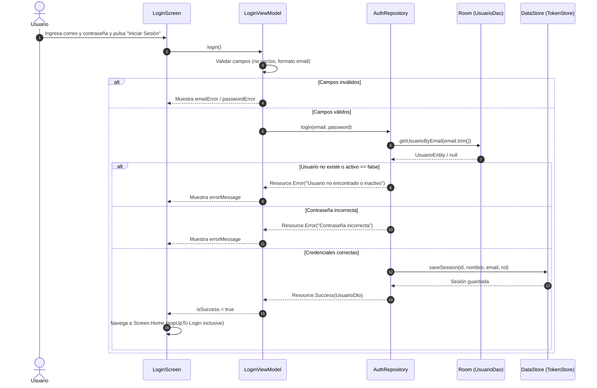

[← Volver al índice](../DOCUMENTACION_TECNICA.md#indice)

### En este capítulo
- [5.a Modelo de seguridad, almacenamiento de credenciales y roles](#c5a)
- [5.b Mecanismo de autenticación y proceso de Login](#c5b)
- [5.c Gestión de sesión persistente con DataStore (TokenStore)](#c5c)
- [5.d Control de inactividad, expiración y cierre de sesión (SesionManager)](#c5d)
- [5.e Validación de permisos por rol en la interfaz de usuario](#c5e)

---

<a id="c5"></a>
## 5. Seguridad, sesión y roles

<a id="c5a"></a>
### 5.a Modelo de seguridad, almacenamiento de credenciales y roles

El modelo de seguridad de **Inventario PyME** está diseñado para operar en entornos comerciales locales sin dependencia de infraestructura en la nube.

#### Credenciales Demo Iniciales (Solo Demostración):
Durante el sembrado inicial de datos demo (`seedInitialData`), la aplicación crea dos cuentas de usuario predeterminadas:

> [!NOTE]
> **Cuenta Administrador (Solo Demostración)**:
> - **Correo**: `admin@inventariopyme.com`
> - **Contraseña**: `admin123`
> - **Rol**: `ADMIN`

> [!NOTE]
> **Cuenta Vendedor (Solo Demostración)**:
> - **Correo**: `vendedor@inventariopyme.com`
> - **Contraseña**: `vendedor123`
> - **Rol**: `VENDEDOR`

#### Roles del Sistema:
1. **`ADMIN` (Administrador)**: Posee privilegio total en el sistema. Puede gestionar productos, crear y editar categorías/proveedores, ver reportes de ventas globales y márgenes de ganancia, administrar usuarios (crear y activar/desactivar) y ejecutar exportaciones, importaciones y borrados en el panel de Ajustes Avanzados.
2. **`VENDEDOR` (Vendedor)**: Restringido a las operaciones cotidianas de caja. Puede registrar ventas en el Punto de Venta, escanear códigos de barras, consultar productos/precios y visualizar el historial de sus propias ventas registradas. No tiene acceso a catálogos, administración de usuarios ni respaldos avanzados.

---

<a id="c5b"></a>
### 5.b Mecanismo de autenticación y proceso de Login

El proceso de autenticación se gestiona en [LoginScreen.kt](file:///C:/Users/Administrador/Desktop/GestionInventarios/app/src/main/java/com/example/gestioninventarios/ui/login/LoginScreen.kt) y [LoginViewModel.kt](file:///C:/Users/Administrador/Desktop/GestionInventarios/app/src/main/java/com/example/gestioninventarios/ui/login/LoginViewModel.kt).

#### Diagrama de Secuencia de Login:



#### Comportamiento de Campos y Autofill:
- Los campos de texto aplican `singleLine = true`.
- El campo de correo aplica `KeyboardType.Email` e `ImeAction.Next`.
- El campo de contraseña cuenta con un ícono para conmutar la visibilidad (`VisualTransformation.None` / `PasswordVisualTransformation`).
- Se desactiva explícitamente el autofill nativo mediante `View.IMPORTANT_FOR_AUTOFILL_NO_EXCLUDE_DESCENDANTS` para prevenir advertencias de accesibilidad en Android Compose.

---

<a id="c5c"></a>
### 5.c Gestión de sesión persistente con DataStore (TokenStore)

La sesión activa se almacena en el archivo `user_session.preferences` a través de Jetpack DataStore Preferences gestionado por [TokenStore.kt](file:///C:/Users/Administrador/Desktop/GestionInventarios/app/src/main/java/com/example/gestioninventarios/data/local/TokenStore.kt).

#### Llaves de Preferencias:
- `is_logged_in` (`booleanPreferencesKey`): `true` cuando existe una sesión activa.
- `user_role` (`stringPreferencesKey`): Rol del usuario (`ADMIN` o `VENDEDOR`).
- `user_name` (`stringPreferencesKey`): Nombre completo del usuario activo.
- `user_email` (`stringPreferencesKey`): Correo electrónico del usuario activo.
- `user_id` (`intPreferencesKey`): Identificador único del usuario.

#### Lectura Reactiva del Estado de Sesión:
El contenedor [AppContainer.kt](file:///C:/Users/Administrador/Desktop/GestionInventarios/app/src/main/java/com/example/gestioninventarios/AppContainer.kt) expone la sesión mediante `Flow<Boolean>`, permitiendo que `NavGraph` reaccione automáticamente ante inicios o cierres de sesión:

```kotlin
val isLoggedIn: Flow<Boolean> = context.dataStore.data.map { prefs ->
    prefs[IS_LOGGED_IN_KEY] == true
}
```

---

<a id="c5d"></a>
### 5.d Control de inactividad, expiración y cierre de sesión (SesionManager)

Para proteger el sistema contra accesos no autorizados en dispositivos compartidos, la clase [SesionManager.kt](file:///C:/Users/Administrador/Desktop/GestionInventarios/app/src/main/java/com/example/gestioninventarios/util/SesionManager.kt) monitorea la inactividad del usuario en segundo plano utilizando `ProcessLifecycleOwner`.

#### Configuración de Tiempos ([SesionConfig.kt](file:///C:/Users/Administrador/Desktop/GestionInventarios/app/src/main/java/com/example/gestioninventarios/util/SesionConfig.kt)):
- **Tiempo Máximo de Inactividad**: 10 minutos (`TIEMPO_SESION_INACTIVA_MIN = 10L`).
- **Equivalencia en Milisegundos**: 600,000 ms (`TIEMPO_SESION_INACTIVA_MS`).

#### Funcionamiento del Control de Inactividad:
1. **Registro de Actividad**: Cada vez que la aplicación se envía a segundo plano (`onStop`), o ante interacciones clave del usuario, se guarda la marca de tiempo actual (`System.currentTimeMillis()`) en `SharedPreferences` (`KEY_ULTIMA_ACTIVIDAD`).
2. **Verificación al Regresar (`onStart`)**: Cuando la aplicación regresa a primer plano, `ProcessLifecycleOwner` ejecuta `onStart()`, el cual invoca a `verificarExpiracion()`.
3. **Cálculo de Diferencia**:
   ```kotlin
   val ahora = System.currentTimeMillis()
   val ultimaActividad = prefs.getLong(KEY_ULTIMA_ACTIVIDAD, 0L)
   val diff = ahora - ultimaActividad
   ```
4. **Expiración y Redirección**: Si `diff > 600,000 ms` (10 minutos), `SesionManager` invoca `cerrarSesion(...)`, limpia el `TokenStore` y emite una alerta a través del flujo `expirationEvent`. El `NavGraph` detecta el evento, muestra el mensaje *"Tu sesión expiró por inactividad. Inicia sesión nuevamente."* en la pantalla de Login y redirige al usuario borrando la pila de navegación (`popUpTo(0)`).

---

<a id="c5e"></a>
### 5.e Validación de permisos por rol en la interfaz de usuario

El control de acceso basado en roles se aplica tanto en la lógica de negocio como en la renderización de la interfaz de usuario:

| Elemento / Función UI | Rol `ADMIN` | Rol `VENDEDOR` | Ubicación en Código |
| :--- | :--- | :--- | :--- |
| **Módulos en Pantalla de Inicio** | Ver todos los módulos (POS, Productos, Catálogos, Reportes, Usuarios). | Ver únicamente POS y Productos. | [HomeScreen.kt](file:///C:/Users/Administrador/Desktop/GestionInventarios/app/src/main/java/com/example/gestioninventarios/ui/home/HomeScreen.kt) |
| **Resumen de KPIs en Inicio** | Muestra Ventas Hoy, Nº Ventas y Alertas de Stock Bajo. | Muestra "Mis Ventas Hoy" y "Última Venta". | [HomeScreen.kt](file:///C:/Users/Administrador/Desktop/GestionInventarios/app/src/main/java/com/example/gestioninventarios/ui/home/HomeScreen.kt) |
| **Creación/Edición/Eliminación de Productos** | Habilitado (FAB y menú contextual visibles). | Deshabilitado (Vista solo lectura). | [ProductosScreen.kt](file:///C:/Users/Administrador/Desktop/GestionInventarios/app/src/main/java/com/example/gestioninventarios/ui/productos/ProductosScreen.kt) |
| **Visualización de Costos y Márgenes** | Visibles en la tarjeta del producto. | Ocultos (Solo se muestra precio de venta). | [ProductosScreen.kt](file:///C:/Users/Administrador/Desktop/GestionInventarios/app/src/main/java/com/example/gestioninventarios/ui/productos/ProductosScreen.kt) |
| **Historial de Ventas en POS** | Puede filtrar el historial por cualquier vendedor o "TODOS". | Solo visualiza sus propias ventas. | [VentaScreen.kt](file:///C:/Users/Administrador/Desktop/GestionInventarios/app/src/main/java/com/example/gestioninventarios/ui/venta/VentaScreen.kt) |
| **Ajustes Avanzados (Respaldos)** | Acceso habilitado a exportar, importar y borrar datos. | Módulo oculto e inaccesible. | [AjustesScreen.kt](file:///C:/Users/Administrador/Desktop/GestionInventarios/app/src/main/java/com/example/gestioninventarios/ui/ajustes/AjustesScreen.kt) |

[← Volver al índice](../DOCUMENTACION_TECNICA.md#indice)
