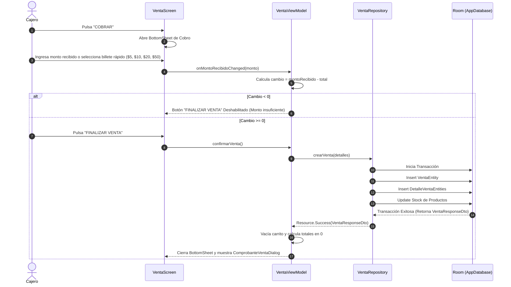

[← Volver al índice](../DOCUMENTACION_TECNICA.md#indice)

### En este capítulo
- [6.a Estructura del Punto de Venta y gestión del carrito (VentaScreen / VentaViewModel)](#c6a)
- [6.b Búsqueda reactiva, sugerencias y escaneo de productos](#c6b)
- [6.c Validación de stock y reglas de existencias en el carrito](#c6c)
- [6.d Proceso transaccional de cobro y registro de venta paso a paso](#c6d)
- [6.e Deshacer eliminación de ítems con Snackbar y eventos reactivos](#c6e)
- [6.f Historial de ventas, filtrado por vendedor y agrupación por fecha](#c6f)

---

<a id="c6"></a>
## 6. Punto de Venta

<a id="c6a"></a>
### 6.a Estructura del Punto de Venta y gestión del carrito (VentaScreen / VentaViewModel)

El módulo de **Punto de Venta (POS)** se implementa en [VentaScreen.kt](file:///C:/Users/Administrador/Desktop/GestionInventarios/app/src/main/java/com/example/gestioninventarios/ui/venta/VentaScreen.kt) y se gestiona mediante [VentaViewModel.kt](file:///C:/Users/Administrador/Desktop/GestionInventarios/app/src/main/java/com/example/gestioninventarios/ui/venta/VentaViewModel.kt). Su interfaz se organiza en dos pestañas principales:
1. **Nueva Venta**: Carrito reactivo de compra, escáner, búsqueda rápida y barra de cobro.
2. **Historial de Ventas**: Registro cronológico de transacciones con filtros por vendedor y detalle emergente.

#### Estructura del Carrito en Memoria (`CartItem`):
Cada partida agregada al carrito se representa con la clase inmutable `CartItem`:
```kotlin
data class CartItem(
    val producto: ProductoDto,
    val cantidad: Int
) {
    val subtotal: Double
        get() = producto.precio * cantidad
}
```

---

<a id="c6b"></a>
### 6.b Búsqueda reactiva, sugerencias y escaneo de productos

El Punto de Venta ofrece dos métodos rápidos para ingresar productos al carrito:

#### 1. Búsqueda por Texto y Menú de Sugerencias:
A medida que el usuario escribe en la barra de búsqueda (`onSearchQueryChanged`), el ViewModel consulta los productos coincidentes en la memoria caché (`productoRepository.getProductosFromCache`) filtrando por nombre o código de barras y limita los resultados a las 6 primeras sugerencias (`take(6)`). Al seleccionar un producto del menú desplegable emergente, este se añade automáticamente al carrito y la búsqueda se limpia.

#### 2. Escaneo por Código de Barras:
Al pulsar el botón del escáner, la app navega a `Screen.Scanner`. Al detectar un código (EAN-13, CODE 128), el resultado se envía de regreso mediante `savedStateHandle`.
- **Si el producto existe**: Se invoca `onBarcodeScanned(codigo)` y el producto se suma al carrito.
- **Si el código no existe**: Se muestra un diálogo informativo (*"Producto no encontrado"*). Si el usuario tiene rol `ADMIN`, el diálogo ofrece un acceso directo a la pantalla de creación de productos.

---

<a id="c6c"></a>
### 6.c Validación de stock y reglas de existencias en el carrito

El repositorio y el ViewModel aplican validaciones estrictas antes de permitir la adición o incremento de productos en el carrito:

1. **Producto sin Existencias**: Si `producto.stock <= 0`, la app bloquea la adición y asigna el mensaje de error: `"El producto [Nombre] está agotado"`.
2. **Límite de Stock en Carrito**: Si el usuario intenta incrementar las unidades en el carrito por encima de las existencias actuales (`cantidad >= producto.stock`), la app detiene el incremento y muestra: `"Stock máximo alcanzado para [Nombre]"`.
3. **Disminución de Unidades**: Al pulsar el botón de restar (`-`), si la cantidad actual es mayor a 1, se decrementa en 1 unidad. Si la cantidad es igual a 1, se remueve el ítem del carrito activando el flujo de deshacer con Snackbar.

---

<a id="c6d"></a>
### 6.d Proceso transaccional de cobro y registro de venta paso a paso

El proceso de venta garantiza la atomicidad y consistencia del inventario.



---

<a id="c6e"></a>
### 6.e Deshacer eliminación de ítems con Snackbar y eventos reactivos

Para evitar pérdidas accidentales de renglones en el carrito durante el cobro, el módulo implementa el gesto de deslizamiento para eliminar (*Swipe-to-Dismiss*) asistido por un evento reactivo de un solo tiro (*One-Shot Event*).

#### Flujo Paso a Paso:
1. El usuario desliza la tarjeta de un producto de derecha a izquierda o reduce su cantidad a 0.
2. `VentaViewModel` retira temporalmente el ítem de la lista del carrito, recalculando el total en tiempo real.
3. El ViewModel emite el evento `VentaEvento.ProductoQuitado(item, posicion)` a través de un `Channel<VentaEvento>`.
4. `VentaScreen` recibe el evento en un `LaunchedEffect` y muestra un `Snackbar` flotante con el texto `"Se quitó '[Nombre]'"` y el botón de acción **"Deshacer"**.
5. Si el usuario pulsa **"Deshacer"** dentro del tiempo de expiración (4 segundos), se invoca `viewModel.restaurarItem(item, posicion)`, insertando el producto exactamente en la posición original y recalculando el total.

---

<a id="c6f"></a>
### 6.f Historial de ventas, filtrado por vendedor y agrupación por fecha

La pestaña **Historial de Ventas** permite auditar todas las transacciones realizadas en el establecimiento.

#### 1. Filtrado por Vendedor (Solo ADMIN):
Los usuarios con rol `ADMIN` visualizan un selector desplegable con la lista de vendedores registrados. Al seleccionar un vendedor específico o la opción `"TODOS"`, el listado se filtra reactivamente. Los usuarios con rol `VENDEDOR` solo pueden visualizar sus propias ventas registradas.

#### 2. Agrupación Cronológica de Ventas:
Las ventas devueltas por la base de datos se parsean a través de `DateTimeUtils.parseFechaVentaToZonedDateTime` utilizando la zona horaria del sistema local. La lista se agrupa dinámicamente por la fecha local (`LocalDate`) del ticket:
- Se muestra el encabezado **"Hoy"** para las ventas del día en curso.
- Se muestra el encabezado **"Ayer"** para las ventas del día anterior.
- Se muestra el formato **"d MMM yyyy"** (ej. `"9 nov 2026"`) para fechas más antiguas.

#### 3. Comprobante / Detalle de Venta Emergente:
Al pulsar sobre cualquier tarjeta del historial, se despliega el modal [DetalleVentaModal](file:///C:/Users/Administrador/Desktop/GestionInventarios/app/src/main/java/com/example/gestioninventarios/ui/venta/VentaScreen.kt), mostrando el folio de ticket, nombre del vendedor, fecha/hora exacta, desglose de renglones (unidades, precio unitario, subtotal) y el botón para compartir el comprobante en texto plano hacia aplicaciones externas (WhatsApp, Email, Impresoras Bluetooth).

[← Volver al índice](../DOCUMENTACION_TECNICA.md#indice)
