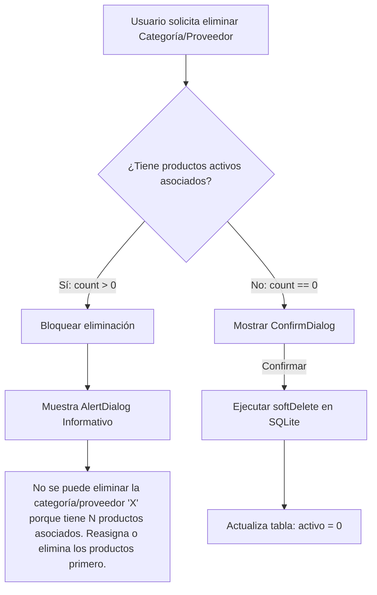

[← Volver al índice](../DOCUMENTACION_TECNICA.md#indice)

### En este capítulo
- [8.a Gestión de categorías de productos (CatalogosScreen / CatalogosViewModel)](#c8a)
- [8.b Gestión de proveedores y datos de contacto](#c8b)
- [8.c Sistema de códigos internos consecutivos de 2 dígitos](#c8c)
- [8.d Reglas de integridad referencial y bloqueo de eliminación](#c8d)

---

<a id="c8"></a>
## 8. Catálogos

<a id="c8a"></a>
### 8.a Gestión de categorías de productos (CatalogosScreen / CatalogosViewModel)

El módulo de administración de catálogos comerciales reside en [CatalogosScreen.kt](file:///C:/Users/Administrador/Desktop/GestionInventarios/app/src/main/java/com/example/gestioninventarios/ui/catalogos/CatalogosScreen.kt) y [CatalogosViewModel.kt](file:///C:/Users/Administrador/Desktop/GestionInventarios/app/src/main/java/com/example/gestioninventarios/ui/catalogos/CatalogosViewModel.kt). Organiza la información mediante una barra de dos pestañas (`TabRow`):
1. **Categorías** (Pestaña 0)
2. **Proveedores** (Pestaña 1)

#### Creación y Edición de Categorías (`FormularioCategoriaBottomSheet`):
- Los usuarios administradores (`ADMIN`) pueden dar de alta nuevas categorías o editar las existentes mediante un panel emergente inferior (`ModalBottomSheet`).
- **Campos del Formulario**: Nombre de la categoría (obligatorio, validación de no duplicidad) y Descripción (opcional).
- **Conteo de Productos**: Cada tarjeta de categoría calcula y despliega dinámicamente la cantidad de productos asociados activos (`categoriaProductCounts`).

---

<a id="c8b"></a>
### 8.b Gestión de proveedores y datos de contacto

La segunda pestaña del módulo administra el catálogo de proveedores comerciales.

#### Creación y Edición de Proveedores (`FormularioProveedorBottomSheet`):
- **Campos del Formulario**:
  - `Nombre del Proveedor`: Requerido. Se valida que el nombre sea único en el sistema.
  - `Nombre de Contacto`: Opcional. Nombre del agente de ventas o representante.
  - `Teléfono`: Opcional. Se valida mediante la expresión regular `^[+0-9\s\-]{7,15}$`. En las tarjetas de la lista, al pulsar sobre el número telefónico se dispara un `Intent(Intent.ACTION_DIAL, Uri.parse("tel:..."))` para iniciar una llamada telefónica directa.
  - `Correo Electrónico`: Opcional. Se valida con el patrón `Patterns.EMAIL_ADDRESS`. Al pulsar sobre el correo en la tarjeta, se dispara un `Intent(Intent.ACTION_SENDTO, Uri.parse("mailto:..."))` para redactar un correo.

---

<a id="c8c"></a>
### 8.c Sistema de códigos internos consecutivos de 2 dígitos

Para alimentar el algoritmo de generación del código de barras interno EAN-13, tanto las categorías como los proveedores poseen un campo obligatorio llamado `codigo`.

#### Reglas de Asignación del Código Interno:
1. **Rango Permitido**: Enteros de 2 dígitos del `1` al `99` (formatos impresos con cero a la izquierda `01`, `02`... `99`).
2. **Asignación Automática**: Al abrir el formulario de creación, el ViewModel calcula el siguiente código disponible invocando `obtenerSiguienteCodigo()`, el cual obtiene el máximo código asignado hasta el momento y le suma 1:
   $$\text{Siguiente Código} = \text{max}(\text{codigo}) + 1$$
3. **Límite Máximo**: El sistema soporta un máximo de 99 categorías y 99 proveedores activos. Si se intenta crear un registro cuyo código supere 99, el repositorio aborta la operación y retorna un error explícito: *"Se alcanzó el límite de 99 categorías/proveedores"*.
4. **Índice Único en Base de Datos**: Las tablas `categorias` y `proveedores` cuentan con índices únicos (`index_categorias_codigo` e `index_proveedores_codigo`) para garantizar la unicidad a nivel de SQLite.

---

<a id="c8d"></a>
### 8.d Reglas de integridad referencial y bloqueo de eliminación

Para evitar inconsistencias en el catálogo de productos y huérfanos en la base de datos, el sistema implementa una **Regla de Integridad Referencial Estricta**:



#### Verificación en Repositorio:
Antes de ejecutar el borrado en la base de datos, los repositorios `CategoriaRepository` y `ProveedorRepository` consultan al `ProductoDao`:

```kotlin
// En CategoriaRepository.kt
val prodCount = productoDao.getCountByCategoria(id)
if (prodCount > 0) {
    return Resource.Error("No se puede eliminar la categoría porque tiene productos asociados")
}
categoriaDao.softDeleteCategoria(id)
```

[← Volver al índice](../DOCUMENTACION_TECNICA.md#indice)
