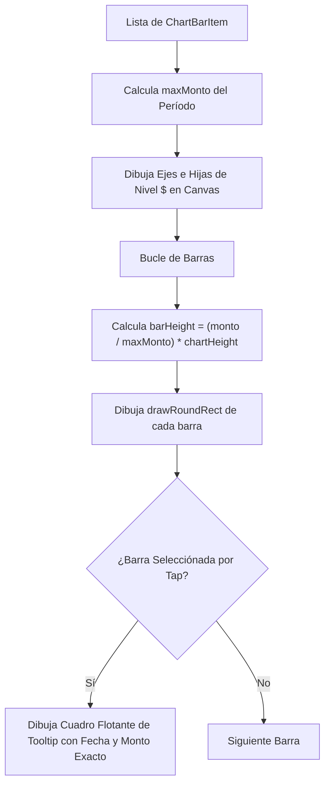

[← Volver al índice](../DOCUMENTACION_TECNICA.md#indice)

### En este capítulo
- [10.a Métricas clave de rendimiento (KPIs) e indicadores de negocio](#c10a)
- [10.b Selección de períodos y cálculo de rangos de fechas (DateTimeUtils)](#c10b)
- [10.c Gráficos estadísticos personalizados en Canvas (CustomBarChart)](#c10c)
- [10.d Análisis de productos más vendidos (Top 5) y alertas de stock bajo](#c10d)
- [10.e Exportación de reportes estadísticos en formato CSV](#c10e)

---

<a id="c10"></a>
## 10. Reportes

<a id="c10a"></a>
### 10.a Métricas clave de rendimiento (KPIs) e indicadores de negocio

El módulo de inteligencia comercial reside en [ReportesScreen.kt](file:///C:/Users/Administrador/Desktop/GestionInventarios/app/src/main/java/com/example/gestioninventarios/ui/reportes/ReportesScreen.kt) y [ReportesViewModel.kt](file:///C:/Users/Administrador/Desktop/GestionInventarios/app/src/main/java/com/example/gestioninventarios/ui/reportes/ReportesViewModel.kt). Calcula y presenta cuatro tarjetas de indicadores clave de rendimiento (KPIs):

1. **Ventas Totales del Período**: Suma acumulada en USD de las ventas registradas durante el rango seleccionado.
2. **Número de Transacciones**: Conteo de tickets de venta emitidos en el período.
3. **Ticket Promedio**: Valor medio por venta realizada, calculado como:
   $$\text{Ticket Promedio} = \frac{\text{Ventas Totales}}{\text{Número de Transacciones}}$$
4. **Alertas de Stock Bajo**: Conteo de productos cuyo stock actual es menor o igual a su stock mínimo. Al pulsar esta tarjeta, la pantalla se desplaza automáticamente hacia la sección de alertas de stock.
5. **Comparativa con el Período Previo**: Porcentaje de incremento o decremento respecto a un período de igual duración inmediatamente anterior:
   $$\text{Variación (\%)} = \frac{\text{Ventas Actuales} - \text{Ventas Previas}}{\text{Ventas Previas}} \times 100$$

---

<a id="c10b"></a>
### 10.b Selección de períodos y cálculo de rangos de fechas (DateTimeUtils)

El usuario puede filtrar los datos de reporte seleccionando tres rangos de tiempo predefinidos (`Periodo`):

| Período (`Periodo`) | Duración | Comportamiento del Gráfico |
| :--- | :--- | :--- |
| `SEMANA` | Últimos 7 días | Renderiza 7 barras individuales (una por cada día de la semana). |
| `MES` | Últimos 30 días | Renderiza 30 barras individuales correspondientes a los últimos 30 días. |
| `TRES_MESES` | Últimos 90 días (12 semanas) | Renderiza 12 barras agrupadas por semanas calendarios. |

#### Cálculo de Rangos en Milisegundos y Zonas Horarias ([DateTimeUtils.kt](file:///C:/Users/Administrador/Desktop/GestionInventarios/app/src/main/java/com/example/gestioninventarios/util/DateTimeUtils.kt)):
- Las marcas de tiempo de las ventas se almacenan en formato ISO-8601 UTC en SQLite (ej. `"2026-11-10T04:18:00Z"`).
- Para evitar desfases de fecha en países con zonas horarias negativas (ej. El Salvador / México UTC-6), `DateTimeUtils` parsea la fecha a milisegundos de época (`toEpochMilli`) y evalúa los límites utilizando la zona horaria del dispositivo (`ZoneId.systemDefault()`).
- `rangoDe(periodo)` calcula `desdeMs` (inclusivo, inicio del día a las 00:00:00) y `hastaMs` (exclusivo, inicio del día siguiente a las 00:00:00).

---

<a id="c10c"></a>
### 10.c Gráficos estadísticos personalizados en Canvas (CustomBarChart)

La visualización gráfica de ventas no utiliza librerías externas pesadas. En su lugar, implementa un componente nativo de alto rendimiento dibujado con **Jetpack Compose Canvas** llamado `CustomBarChart`.



#### Características del Gráfico Canvas:
- **Escalado Dinámico**: El alto de las barras se calcula proporcionalmente al valor máximo alcanzado en el período (`maxMonto`).
- **Resaltado del Día Actual**: La barra correspondiente a la fecha de hoy se dibuja con el color verde semántico de éxito (`Semantico.colores.exito`), mientras que las demás se dibujan con el azul primario.
- **Detección de Toques (Tap Gestures)**: Mediante `pointerInput(bars)` y `detectTapGestures`, detecta las coordenadas del toque del usuario, identifica la barra presionada y despliega un **Tooltip emergente flotante** con el monto exacto de la venta y la fecha.

---

<a id="c10d"></a>
### 10.d Análisis de productos más vendidos (Top 5) y alertas de stock bajo

#### 1. Top 5 Productos Más Vendidos:
El ViewModel extrae los renglones de detalle (`DetalleVentaEntity`) de todas las ventas del período, los agrupa por el nombre del producto, calcula la suma de unidades vendidas y el monto acumulado, y selecciona los 5 productos líderes:

```kotlin
val topProds = ventasPeriodoActual
    .flatMap { it.original.detalles }
    .groupBy { it.productoNombre }
    .map { (nombre, detalles) ->
        TopProductoItem(
            productoNombre = nombre,
            cantidadVendida = detalles.sumOf { it.cantidad },
            totalMonto = detalles.sumOf { it.subtotal }
        )
    }
    .sortedByDescending { it.cantidadVendida }
    .take(5)
```

#### 2. Sección de Alertas de Stock Bajo / Agotado:
Lista los productos activos cuya existencia actual sea menor o igual a su stock mínimo, mostrando su nombre, código de barras, categoría y una insignia coloreada (`StockBadge`) en color rojo (si está agotado) o naranja (si está en nivel crítico).

---

<a id="c10e"></a>
### 10.e Exportación de reportes estadísticos en formato CSV

El módulo permite compartir los reportes estadísticos mediante la función `exportarReporteCSV(context, uiState)` en [ReportesScreen.kt](file:///C:/Users/Administrador/Desktop/GestionInventarios/app/src/main/java/com/example/gestioninventarios/ui/reportes/ReportesScreen.kt).

#### Estructura del Archivo CSV Generado:
1. **Encabezado del Reporte**: Título del negocio y período evaluado.
2. **Sección Resumen**: Ventas totales, número de transacciones y ticket promedio.
3. **Sección Productos Más Vendidos**: Tabla CSV con columnas `Producto`, `Cantidad` y `Total Venta`.
4. **Sección Alertas de Stock**: Tabla CSV con columnas `Producto`, `Codigo`, `Stock Actual`, `Stock Minimo`, `Categoria` y `Proveedor`.

#### Envío mediante Intent Android:
Al generar el texto CSV, se abre el selector nativo del sistema para compartir archivos mediante un `Intent(Intent.ACTION_SEND)` con tipo MIME `"text/csv"`, permitiendo enviar el reporte por correo electrónico, guardarlo en Google Drive o enviarlo a aplicaciones de mensajería.

[← Volver al índice](../DOCUMENTACION_TECNICA.md#indice)
