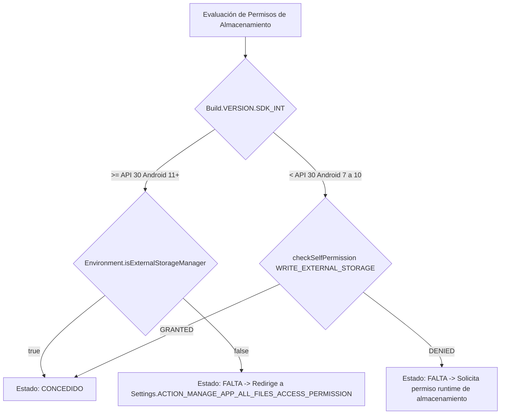

[← Volver al índice](../DOCUMENTACION_TECNICA.md#indice)

### En este capítulo
- [12.a Arquitectura de respaldos JSON e integridad de datos (RespaldoJsonManager)](#c12a)
- [12.b Proceso de exportación de respaldos paso a paso](#c12b)
- [12.c Proceso de importación de respaldos, resolución de duplicados y mapeo de IDs](#c12c)
- [12.d Procedimiento de eliminación total de datos](#c12d)
- [12.e Gestión de almacenamiento externo, rutas y permisos por versión de Android](#c12e)

---

<a id="c12"></a>
## 12. Respaldos y gestión de datos

<a id="c12a"></a>
### 12.a Arquitectura de respaldos JSON e integridad de datos (RespaldoJsonManager)

La preservación e intercambio de información en **Inventario PyME** se realiza mediante archivos de respaldo planos en formato JSON. El procesamiento de estos archivos se implementa en [RespaldoJsonManager.kt](file:///C:/Users/Administrador/Desktop/GestionInventarios/app/src/main/java/com/example/gestioninventarios/util/RespaldoJsonManager.kt) utilizando la API de lectura y escritura en streaming de Android (`android.util.JsonWriter` y `android.util.JsonReader`) para minimizar el consumo de memoria RAM en archivos de gran tamaño.

#### Constantes de Formato de Respaldo:
- **Identificador de Aplicación (`APP_IDENTIFIER`)**: `"InventarioPYME"`
- **Versión de Formato Actual (`FORMATO_VERSION`)**: `2`
- **Versión de Base de Datos (`VERSION_BD`)**: `3`
- **Tamaño Máximo Permitido (`TAMANO_MAX_BYTES`)**: 50 MB (52,428,800 bytes).

#### Estructura del Archivo JSON de Respaldo:
```json
{
  "app": "InventarioPYME",
  "formato": 2,
  "versionBD": 3,
  "exportadoEn": 1773087480000,
  "conteos": {
    "categorias": 3,
    "proveedores": 2,
    "productos": 10,
    "ventas": 2,
    "detalle_venta": 5
  },
  "categorias": [
    { "id": 1, "nombre": "Bebidas", "descripcion": "Refrescos", "activo": true, "codigo": 1 }
  ],
  "proveedores": [
    { "id": 1, "nombre": "Distribuidora del Norte", "contacto": "Juan Pérez", "telefono": "555-0101", "email": "contacto@distnorte.com", "activo": true, "codigo": 1 }
  ],
  "productos": [
    { "id": 1, "codigoBarras": "2010100000013", "nombre": "Coca-Cola 600ml", "precio": 1.25, "costo": 0.85, "stock": 50, "stockMinimo": 10, "categoriaId": 1, "proveedorId": 1, "activo": true, "categoriaNombre": "Bebidas", "proveedorNombre": "Distribuidora del Norte" }
  ],
  "ventas": [
    { "id": 1, "usuarioId": 2, "usuarioNombre": "Carlos Vendedor", "vendedorCorreo": "vendedor@inventariopyme.com", "vendedorNombre": "Carlos Vendedor", "fechaVenta": "2026-11-10T04:18:00Z", "total": 3.30 }
  ],
  "detalle_venta": [
    { "id": 1, "ventaId": 1, "productoId": 1, "productoNombre": "Coca-Cola 600ml", "codigoBarras": "2010100000013", "cantidad": 2, "precioUnitario": 1.25, "subtotal": 2.50 }
  ]
}
```

> [!IMPORTANT]
> **Tratamiento de la Tabla Usuarios**:
> Las cuentas de usuario (`usuarios`) **NO forman parte de los respaldos en la Versión 2**: no se exportan ni se importan para evitar comprometer contraseñas o sobreescribir usuarios locales. Sin embargo, para asociar correctamente las ventas a un usuario durante una importación, el objeto `ventas` incluye desnormalizados los campos `vendedorCorreo` y `vendedorNombre`.

---

<a id="c12b"></a>
### 12.b Proceso de exportación de respaldos paso a paso

La exportación se gestiona mediante la cooperación entre [AjustesAvanzadosViewModel.kt](file:///C:/Users/Administrador/Desktop/GestionInventarios/app/src/main/java/com/example/gestioninventarios/ui/ajustes/AjustesAvanzadosViewModel.kt) y [AlmacenRespaldos.kt](file:///C:/Users/Administrador/Desktop/GestionInventarios/app/src/main/java/com/example/gestioninventarios/util/AlmacenRespaldos.kt).

```mermaid
sequenceDiagram
    autonumber
    actor Admin
    participant UI as AjustesAvanzadosScreen
    participant VM as AjustesAvanzadosViewModel
    participant DB as Room (AppDatabase)
    participant Storage as AlmacenRespaldos
    participant Json as RespaldoJsonManager

    Admin->>UI: Pulsa "Exportar respaldo ahora"
    UI->>VM: exportarRespaldo()
    VM->>VM: Comprobar estado de permiso de archivos
    VM->>DB: appDatabase.withTransaction (Snapshot Atómico)
    DB-->>VM: Retorna (RespaldoDatosExportar, dbCounts)
    VM->>Storage: guardarRespaldoJsonVerificado(...)
    Storage->>Storage: Crear archivo temporal "InventarioPYME_*.json.tmp"
    Storage->>Json: exportarAStream(datos, fileOutputStream)
    Json-->>Storage: Streaming completado & sync()
    Storage->>Json: verificarArchivoTemporal(fileTmp, dbCounts)
    alt Conteos de array no coinciden con los conteos de base de datos
        Json-->>Storage: Failure(Conteos no coinciden)
        Storage->>Storage: Elimina archivo temporal .tmp
        Storage-->>VM: Result.failure(ex)
        VM-->>UI: Muestra ErrorHumano ("El respaldo no quedó completo")
    else Verificación Exitosa
        Json-->>Storage: Success(RespaldoValidacionInfo)
        Storage->>Storage: Renombra .tmp a .json definitivo
        Storage->>Storage: MediaScannerConnection.scanFile (Notifica al sistema)
        Storage-->>VM: Result.success(RespaldoResultado)
        VM->>VM: Actualiza PreferenciasManager (fecha y ubicación)
        VM-->>UI: Muestra AlertDialog "Respaldo Creado Exitosamente"
    end
```



---

<a id="c12c"></a>
### 12.c Proceso de importación de respaldos, resolución de duplicados y mapeo de IDs

El procedimiento de importación se diseñó bajo la premisa de **No Destrucción**: los registros del archivo se integran a la base de datos como elementos completamente **NUEVOS**, conservando la información existente.

#### 1. Respaldo Automático Previo y Posterior:
Antes de insertar ningún dato, el sistema genera automáticamente una copia de seguridad del estado actual de la base de datos en la subcarpeta `Otros` (`InventarioPYME_previo-a-importar_YYYY-MM-DD_HH-mm-ss.json`). Una vez concluida la importación, genera una segunda copia (`InventarioPYME_posterior-a-importar_...json`).

#### 2. Mapeo Dinámico de Identificadores (Re-Keying):
Dado que los registros importados provienen de otra base de datos y pueden colisionar con los identificadores autoincrementales actuales, se mantienen cuatro mapas en memoria durante la transacción:
`mapCatId: Map<OldId, NewId>`, `mapProvId: Map<OldId, NewId>`, `mapProdId: Map<OldId, NewId>` y `mapVtaId: Map<OldId, NewId>`.

#### 3. Algoritmos de Resolución de Duplicados (Unicidad):
- **Nombres de Categorías y Proveedores (`hacerNombreUnico`)**: Si el nombre ya existe en la base de datos local (case-insensitive), se le añade el sufijo `" (importado)"`. Si el candidato vuelve a colisionar, incrementa un contador numérico (ej. `"Bebidas (importado) 2"`).
- **Códigos de Barras de Productos (`hacerCodigoBarrasUnico`)**: Si el código de barras colisiona con uno existente, se le añade el sufijo `"-I1"`, `"-I2"`, etc. (ej. `"2010100000013-I1"`).
- **Códigos Internos de 2 Dígitos (`obtenerSiguienteCodigoInterno`)**: Busca en el rango del 1 al 99 el primer entero que no esté en uso en la tabla local.
- **Asignación de Vendedor en Ventas**: La venta se asocia a un usuario local buscando su correo (`vendedorCorreo`). Si el correo no existe en la instalación actual, la venta se asigna al administrador que está ejecutando la importación.

---

<a id="c12d"></a>
### 12.d Procedimiento de eliminación total de datos

El panel de Ajustes Avanzados incluye una **"Zona de Peligro"** para borrar completamente la información operativa del negocio.

#### Pasos del Procedimiento de Eliminación Total:
1. **Solicitud y Validación de Permisos**: El administrador pulsa *"Eliminar todos los datos"*.
2. **Respaldo de Seguridad Obligatorio**: Se genera automáticamente una copia de seguridad en la subcarpeta `Otros` (`InventarioPYME_previo-a-eliminar_*.json`). Si esta exportación falla, la eliminación se aborta inmediatamente.
3. **Diálogo de Confirmación con Temporizador de 3 Segundos**: Se presenta un diálogo de advertencia con un temporizador regresivo de 3 segundos en el botón de confirmación (`SEGUNDOS_CONFIRMACION_ELIMINAR`). El botón permanece deshabilitado hasta que el contador llega a 0.
4. **Ejecución Transaccional**: DENTRO de una transacción SQLite (`appDatabase.withTransaction`), se vacían las 5 tablas operativas:
   ```kotlin
   productoDao.clearAll()
   categoriaDao.clearAll()
   proveedorDao.clearAll()
   ventaDao.clearAll() // Al eliminar ventas, CASCADE elimina detalle_ventas
   ```
5. **Preservación de Usuarios y Preferencias**: La tabla `usuarios` **NO SE TOCA** (las cuentas de acceso permanecen intactas). Las preferencias de siembra inicial en `PreferenciasManager` se restablecen a `setDatosSembrados(false)` para permitir una nueva siembra limpia si el usuario lo desea.

---

<a id="c12e"></a>
### 12.e Gestión de almacenamiento externo, rutas y permisos por versión de Android

Debido a los cambios de políticas de privacidad y Scoped Storage introducidos en las distintas versiones de Android, la aplicación implementa una estrategia adaptativa en [AlmacenRespaldos.kt](file:///C:/Users/Administrador/Desktop/GestionInventarios/app/src/main/java/com/example/gestioninventarios/util/AlmacenRespaldos.kt) y [EstadoAccesoArchivos.kt](file:///C:/Users/Administrador/Desktop/GestionInventarios/app/src/main/java/com/example/gestioninventarios/util/EstadoAccesoArchivos.kt):

#### Estructura Física de Carpetas en la Raíz de Almacenamiento:
```
Almacenamiento Principal / (Environment.getExternalStorageDirectory())
└── Inventario PYME /
    └── Respaldos de Datos /                # Carpeta principal de exportación
        └── Otros /                         # Copias de seguridad automáticas (previas/posteriores)
```

#### Estrategia por Versión de Android:



- **Android 7.0 a 9.0 (API 24 - 28)**: Requiere el permiso `WRITE_EXTERNAL_STORAGE` concedido en tiempo de ejecución.
- **Android 10 (API 29)**: Requiere `WRITE_EXTERNAL_STORAGE` y la bandera `android:requestLegacyExternalStorage="true"` en el Manifiesto.
- **Android 11 a 14+ (API 30 - 34)**: Requiere el permiso especial `MANAGE_EXTERNAL_STORAGE` concedido por el usuario en la pantalla del sistema `Settings.ACTION_MANAGE_APP_ALL_FILES_ACCESS_PERMISSION`.
- **Selector de Documentos ([OpenDocumentInBackupFolderContract.kt](file:///C:/Users/Administrador/Desktop/GestionInventarios/app/src/main/java/com/example/gestioninventarios/util/OpenDocumentInBackupFolderContract.kt))**: Al importar un archivo en dispositivos con API 26+, el contrato personalizado preconfigura la propiedad `DocumentsContract.EXTRA_INITIAL_URI` apuntando directamente a la URI de la carpeta `primary:Inventario PYME/Respaldos de Datos`.

[← Volver al índice](../DOCUMENTACION_TECNICA.md#indice)
